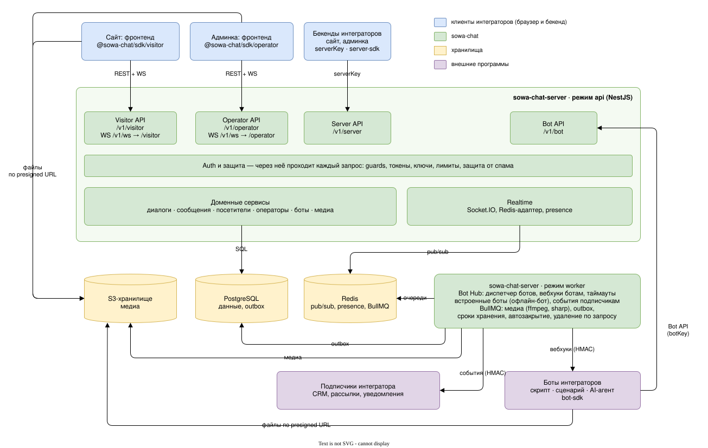
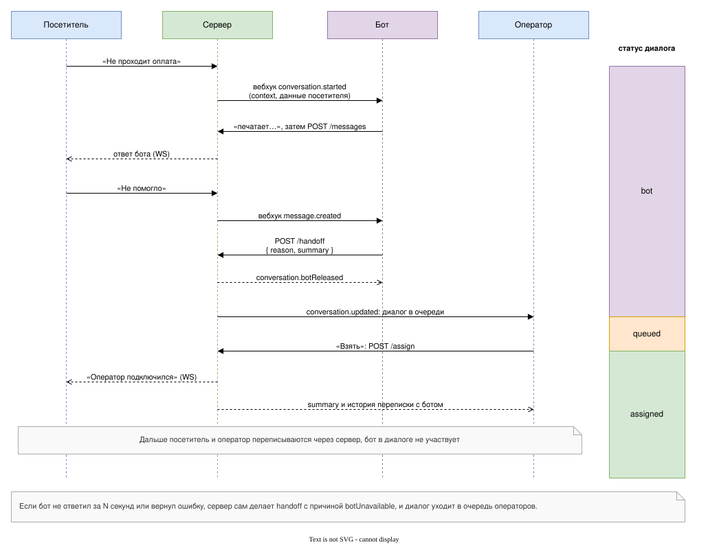
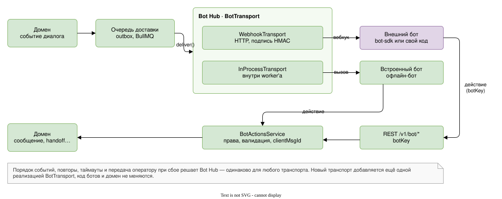
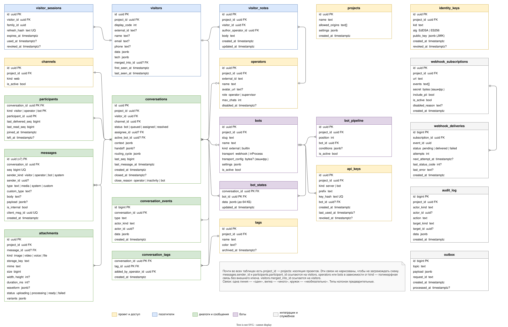
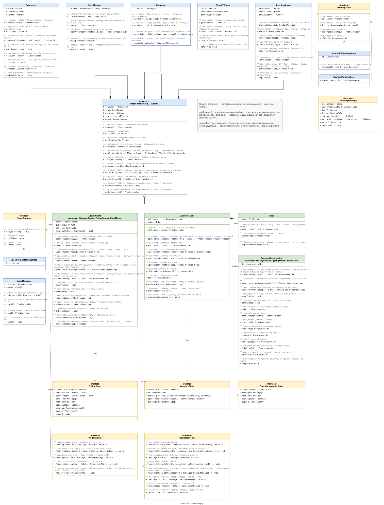
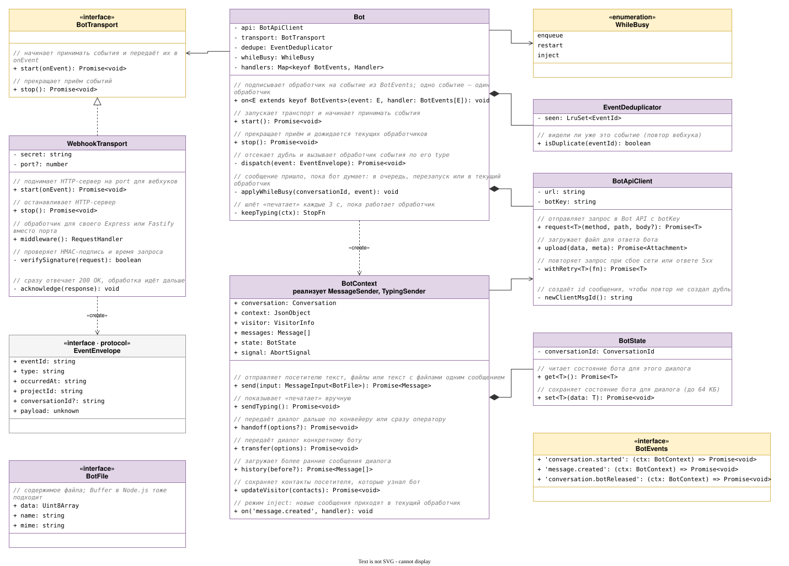
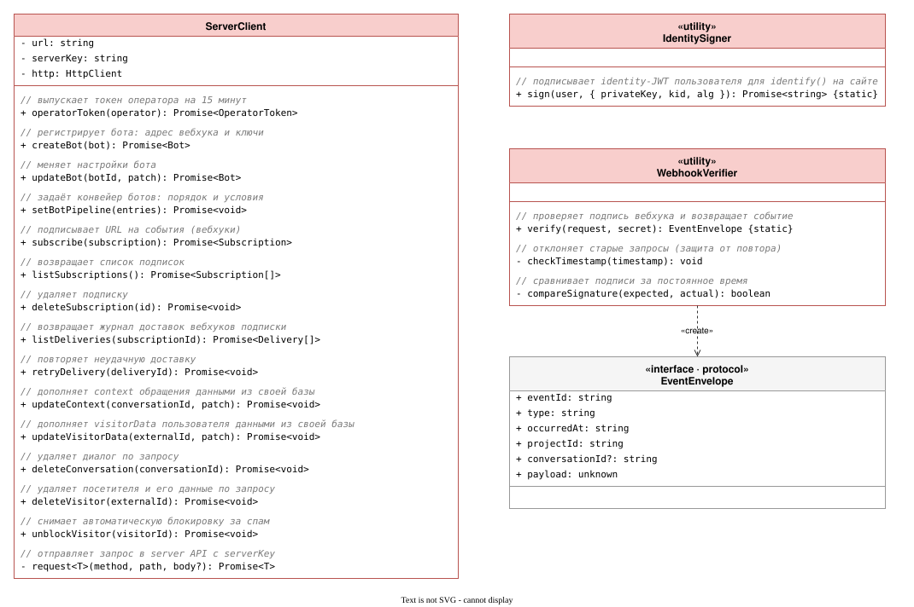
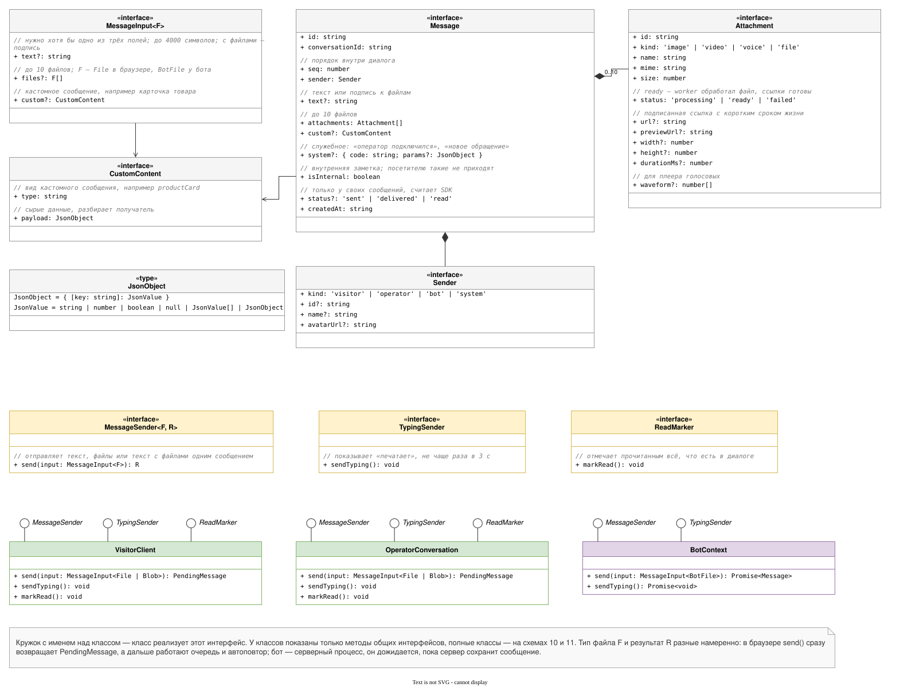
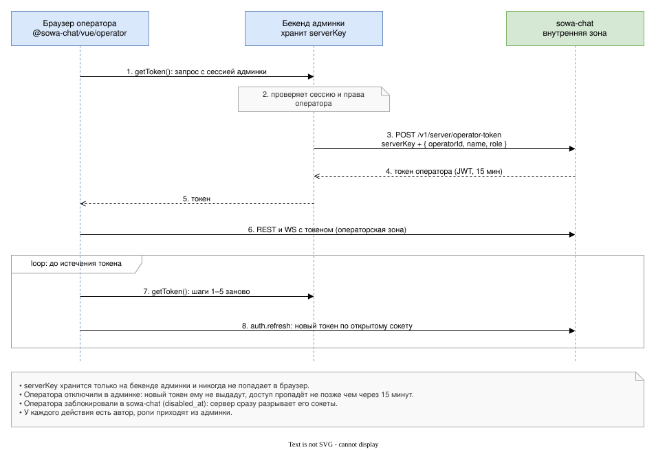

# sowa-chat: план проекта

> **Статус: черновик, не утверждён.** Пока план не утверждён, работы по проекту не начинаем: ни кода, ни репозитория, ни инфраструктуры.
>
> Пункты со статусом «предложено» ждут утверждения. Правки вносим прямо в этот файл.
>
> Примеры кода в плане (SDK, `bot-sdk`, `server-sdk`) иллюстрируют идею, а не фиксируют интерфейс. Интерфейсы пакетов согласуются отдельно, до начала работ над ними.
>
> Обновлён: 26.10.2026

## 0. Журнал решений

| № | Решение | Статус |
|---|---|---|
| 1 | Self-hosted микросервис: всё поставляется вместе в docker-compose и работает изолированно | требование |
| 2 | Мы поставляем образ, docker-compose и документацию для DevOps; Kubernetes и прод-инфраструктуру настраивают DevOps | требование |
| 3 | Несколько реплик сервера, устойчивость к обрывам соединений | требование |
| 4 | Нагрузка: до 1000 одновременных пользователей | требование |
| 5 | Бекенд на NestJS + PostgreSQL, SDK на TypeScript | утверждено |
| 6 | Валидация и контракты на Zod: общие схемы для бека и фронта | утверждено |
| 7 | SDK без привязки к фреймворку: состояние — неизменяемый снимок с подпиской (`getSnapshot` / `subscribe`), к React, Vue или Svelte его подключают несколькими строками, отдельных адаптеров нет; готового UI-виджета нет (раздел 14) | требование |
| 8 | Написать может любой: анонимные посетители, идентификация залогиненных, склейка при входе | требование |
| 9 | Произвольные данные (context) при старте диалога, типизация под любую админку | требование |
| 10 | Основной сценарий: подключаемый бот ведёт диалог, операторы видят диалог только после handoff; supervisor видит диалоги у ботов в режиме чтения и может забрать диалог себе (раздел 8). Ботом может быть любая программа: скрипт, сценарий, AI-агент | требование |
| 11 | Каналы кроме веба (Telegram, WhatsApp) закладываем в архитектуру сразу, реализуем только веб-канал | требование |
| 12 | Монорепо на pnpm + turborepo: `server`, `protocol`, `sdk`, `bot-sdk`, `server-sdk` | утверждено |
| 13 | Запись через REST, события через WebSocket (Socket.IO) | утверждено |
| 14 | Redis: рассылка событий между репликами, presence, очереди BullMQ, счётчики. Код работает через стандартный протокол, поэтому совместимые серверы (Valkey, Dragonfly) подключаются без изменений кода | утверждено |
| 15 | Медиа в S3-совместимом хранилище, код использует только базовые операции S3 API; в docker-compose — SeaweedFS (официальные образы MinIO больше не скачиваются). MinIO, который используют команды компании, и любое другое S3 подключаются через `.env` (раздел 10) | утверждено |
| 16 | `project_id` во всех таблицах: одна установка обслуживает несколько сайтов и админок; изоляция через токен, репозитории с контекстом проекта и e2e-тесты | утверждено |
| 17 | Секретные ключи живут только на бекендах; оператор получает короткоживущий токен через бекенд админки | утверждено |
| 18 | Отдельный ключ под каждую задачу: серверный, identity (асимметричный), у каждого бота свой; хранение, ротация и действия при утечке — в разделе 15 | утверждено |
| 19 | API разделён по аудиториям, каждая зона слушает свой порт, и сервис сам не пускает запросы зоны на чужой порт; безопасные значения по умолчанию и режимы development/production (раздел 15) | утверждено |
| 20 | Термины: «бот» — любая программа, которая ведёт диалог до оператора; «канал» — транспорт (веб, Telegram, WhatsApp) | утверждено |
| 21 | Каждый бот — отдельный сервис, мы предоставляем только API. Транспорт — вебхук + Bot API по HTTP; архитектура позволяет добавить другой транспорт (WebSocket), не меняя доменную логику и код ботов (раздел 8) | утверждено |
| 22 | ORM: TypeORM через `@nestjs/typeorm` — первоклассная интеграция от команды Nest (правила в разделе 11) | утверждено |
| 24 | Пакеты публикуются в публичный npm; все пакеты и образ сервера версионируются вместе, одной версией | утверждено |
| 25 | Раздельные пакеты в scope `@sowa-chat` (`sdk`, `bot-sdk`, `server-sdk`, `protocol`), а не один пакет с подпутями (раздел 3) | утверждено |
| 26 | Переменные окружения: стандартные без префикса (`DATABASE_URL`, `REDIS_URL`, `NODE_ENV`, `OTEL_*`), собственные с префиксом `SOWA_`; в коде — типизированный конфиг без префиксов (разделы 13, 17) | утверждено |
| 27 | Исходящие события: любой сервис подписывается на события проекта (вебхук с фильтром по типам) и сам решает, что делать; уведомление посетителя об ответе идёт через событие `visitor.replyUnread` (раздел 12) | утверждено |
| 28 | Встроенные системные боты: наш код на том же протоколе через внутренний транспорт, настраиваются без кода; первый — офлайн-бот для нерабочего времени (раздел 8) | утверждено |
| 29 | Сервер может разворачивать у себя (self-hosted) и дорабатывать любой; предоставлять его как SaaS третьим лицам — только по договору с правообладателем. Сервер под Elastic License 2.0, SDK-пакеты под MIT. Формулировки проверяют юристы до первого публичного релиза | утверждено |
| 30 | Статус «доставлено»: SDK получателя подтверждает получение по `seq` (разделы 14, 16) | утверждено |
| 31 | Очередь неотправленных сообщений и файлов в IndexedDB; срок жизни — опция SDK `pendingMaxAgeSeconds` (по умолчанию 30 минут); файл сохраняется, только если помещается в хранилище браузера (раздел 14) | утверждено |
| 32 | Внешние pull request'ы принимаются только после подписи CLA: контрибьютор один раз даёт правообладателю право менять лицензию и выдавать коммерческие лицензии на свой вклад. Подписывается кнопкой в pull request (CLA Assistant), без подписи PR не сливается. Текст CLA готовят юристы | утверждено |
| 33 | Основа интеграции с бекендами — HTTP API с OpenAPI и стандартные подписи (JWT, HMAC) с тестовыми векторами и примерами на нескольких языках; пакет `@sowa-chat/server-sdk` для Node.js — удобство поверх этого, используется и в демо-админке (раздел 3) | утверждено |
| 34 | Диспетчер и конвейер ботов (Chain of Responsibility): боты выстраиваются в упорядоченный список `[бот1, бот2, …]` с необязательными декларативными условиями; диспетчер — модуль сервера, не бот и не AI — отдаёт диалог первому подходящему, при передаче продолжает со следующего, конец конвейера — очередь; офлайн-бот — обычный бот конвейера; защита от зацикливания (движение только вперёд, бот не выбирается повторно в цикле, не больше `SOWA_MAX_BOT_HOPS` смен) (раздел 8) | утверждено |
| 35 | Обращения: для оператора каждое обращение — отдельная таска; закрытое переоткрывается, только если посетитель написал в течение `SOWA_REOPEN_WINDOW_HOURS`, иначе создаётся новое; оператор видит все обращения клиента в карточке; в рамках таски вернуть диалог боту нельзя; посетитель видит одну непрерывную ленту (разделы 5, 8) | утверждено |
| 36 | Именование: camelCase везде — код, JSON API, query-параметры, имена событий, значения перечислений, поля логов; snake_case только в БД. Исключения по внешним стандартам: переменные окружения в UPPER_SNAKE_CASE (решение 26), пути URL в kebab-case, заголовки HTTP, синтаксис docker-compose | требование |

## Схемы

Схемы лежат в `docs/diagrams/` в формате `.drawio.svg`: в браузере и в GitLab/GitHub они открываются как картинки, а в draw.io (Desktop или расширение для VS Code) редактируются как обычные схемы.

| Схема | Раздел плана |
|---|---|
| [Архитектура](docs/diagrams/01-architecture.drawio.svg) | 2 |
| [Зоны API](docs/diagrams/02-api-zones.drawio.svg) | 12, 15 |
| [Бот → оператор](docs/diagrams/03-bot-handoff.drawio.svg) | 8 |
| [Доступ оператора](docs/diagrams/04-operator-access.drawio.svg) | 15 |
| [Статусы диалога](docs/diagrams/05-conversation-states.drawio.svg) | 8 |
| [Путь сообщения](docs/diagrams/06-message-flow.drawio.svg) | 13, 16 |
| [Транспорт ботов](docs/diagrams/08-bot-transport.drawio.svg) | 8 |
| [Модель данных](docs/diagrams/09-database.drawio.svg) | 11 |
| [Как читать UML-схемы](docs/diagrams/uml-guide.drawio.svg) | 14 |
| [SDK посетителя и оператора (UML)](docs/diagrams/10-sdk-client.drawio.svg) | 14 |
| [SDK бота (UML)](docs/diagrams/11-sdk-bot.drawio.svg) | 14 |
| [SDK бекенда (UML)](docs/diagrams/12-sdk-server.drawio.svg) | 14 |
| [Общие типы и интерфейсы (UML)](docs/diagrams/13-protocol.drawio.svg) | 14 |

## 1. Цель

**Цель.** Чат между посетителем сайта и оператором. Посетитель пишет на сайте, первым ему отвечает бот: скрипт, сценарий или AI-агент, это выбирает интегратор. Когда нужен человек, бот передаёт диалог оператору в админку. Сервер чата работает как самостоятельный микросервис, к нему через SDK подключаются любой сайт, любая админка и любой бот.

**Что делаем:**
- текстовые сообщения в реальном времени, история, статусы прочтения;
- анонимные и идентифицированные посетители;
- медиа: фото, голосовые, видео, файлы;
- произвольные данные о посетителе и обращении (context);
- подключаемые боты, которые ведут диалог до передачи оператору, и SDK для их написания;
- архитектура каналов, реализован только веб-канал (браузер);
- SDK для посетителя и оператора без привязки к фреймворку;
- образ, docker-compose и документация для DevOps.

## 2. Архитектура



Роли компонентов:
- **api**: REST и WebSocket, без состояния в памяти;
- **worker**: фоновые задачи (обработка медиа, вебхуки ботам и подписчикам, таймауты, сроки хранения, outbox);
- **PostgreSQL**: источник истины для всех данных;
- **Redis**: доставка событий между репликами, presence, очереди;
- **S3-хранилище** (в docker-compose SeaweedFS): файлы;
- **боты**: внешние — отдельные процессы интеграторов, сервер общается с ними по HTTP; встроенные — наш код внутри worker'а.

## 3. Структура репозитория

```
sowa-chat/
├─ apps/
│  ├─ server/        NestJS: режимы api | worker | migrate | cli
│  └─ playground/    демо-сайт, демо-админка на Vue (бекенд на `server-sdk`), демо-боты (скрипт и AI-агент)
├─ packages/
│  ├─ protocol/      zod-схемы, типы, общие интерфейсы SDK (`MessageSender` и др.), константы событий, коды ошибок
│  ├─ sdk/           ядро + /visitor + /operator
│  ├─ bot-sdk/       обработчики событий, клиент Bot API, транспорт webhook
│  └─ server-sdk/    клиент server API для бекендов на Node.js: токены операторов, signIdentity, verifyWebhook
├─ deploy/
│  └─ compose/       docker-compose.yml (прод), docker-compose.dev.yml (разработка и демо), nginx.conf, .env.example
└─ docs/
   ├─ diagrams/      схемы в draw.io (.drawio.svg)
   ├─ integration/   для интеграторов: OpenAPI, подписи с тестовыми векторами, примеры на curl, PHP, Python, Go
   └─ devops.md      что сервис гарантирует и что ему нужно от инфраструктуры
```

Зачем монорепо: сервер и все пакеты берут `protocol` прямо из исходников, а не из опубликованной версии. Если поменять формат сообщения или события и забыть обновить сервер или SDK, TypeScript покажет ошибку при сборке, и несовместимая версия не попадёт к пользователям.

**Публикация и версии**
- Пакеты публикуются в публичный npm, пользователь ставит только нужные:

  ```
  npm i @sowa-chat/sdk        # сайт или админка, любой фреймворк
  npm i @sowa-chat/bot-sdk    # разработчик бота (Node.js)
  npm i @sowa-chat/server-sdk # бекенд сайта или админки (Node.js)
  ```

  ```ts
  import { createVisitorClient } from '@sowa-chat/sdk/visitor';
  import { createOperatorClient } from '@sowa-chat/sdk/operator';
  import { createBot } from '@sowa-chat/bot-sdk';
  ```
- `@sowa-chat/protocol` вручную не ставят: он приходит зависимостью `sdk`, `bot-sdk` и `server-sdk`.
- Основа интеграции — HTTP API, а не пакеты: бекенд на любом языке работает с ним напрямую по OpenAPI-описанию. Подписи построены на стандартах (JWT для identity, HMAC-SHA256 для вебхуков), и в документации для интеграторов есть точное описание, тестовые векторы и примеры на curl, PHP, Python и Go. `server-sdk` — удобство для бекендов на Node.js, им же пользуется демо-админка в playground.
- Пакеты публикуются в scope организации `@sowa-chat` на npmjs.com: публиковать в него могут только её участники, поэтому официальные пакеты не спутать с подделками. В каждом пакете `"publishConfig": { "access": "public" }`.
- Все пакеты и Docker-образ сервера выпускаются одной версией: changesets в режиме `fixed`, образ получает тот же тег.
- Внутри мажорной версии сервер обратно совместим со старыми SDK: обновление сервера не заставляет все сайты одновременно обновлять пакеты. Несовместимые изменения API — только с новой мажорной версией.
- Публикация только из CI по тегу релиза, через trusted publishing (OIDC) без долгоживущих токенов npm, с provenance.

Структура сервера: контроллеры разделены по аудиториям, у каждой группы свои guards, а доменные сервисы общие.

```
apps/server/src/
├─ domain/       conversations, messages, visitors, operators, bots, attachments
├─ api/
│  ├─ visitor/   REST и WS-namespace посетителя
│  ├─ operator/  REST и WS-namespace оператора
│  ├─ bot/       Bot API
│  └─ server/    server-to-server API
├─ channels/     адаптеры каналов: только web
├─ bot-hub/      доставка событий ботам, транспорты: webhook, in-process (встроенные боты)
├─ builtin-bots/ встроенные боты: офлайн-бот
├─ events/       исходящие события: подписки, доставка, журнал доставок
├─ abuse/        автоматическая защита от спама
├─ telemetry/    TelemetryInterceptor, шина событий, логгер, метрики
├─ realtime/     Socket.IO, Redis-адаптер, presence
├─ jobs/         процессоры BullMQ: медиа, сроки хранения, автозакрытие, удаление по запросу
└─ infra/        БД, Redis, S3, конфиг, health, логи
```

**Правило слоёв.** Каждая папка — один или несколько модулей Nest (`@Module`). Модули не изолированы полностью, а инкапсулированы: наружу видно только то, что модуль явно отдаёт через `exports`, а зависимости подключаются явно через `imports`. Зависимости идут строго в одну сторону:

| Слой | Модули | Может зависеть от | Что делает |
|---|---|---|---|
| Вход | `api/*` | `domain`, `telemetry` | тонкие контроллеры и гейтвеи, guards своей зоны; бизнес-логики нет |
| Логика | `domain/*` | `infra`, `telemetry` | вся бизнес-логика; ничего не знает про HTTP, сокеты и очереди |
| Подписчики событий | `realtime`, `bot-hub`, `builtin-bots`, `events`, `jobs`, `abuse` | `domain`, `infra`, `telemetry` | реагируют на доменные события: рассылка в сокеты, доставка ботам и подписчикам, фоновые задачи |
| Инфраструктура | `infra/*` | — | БД, Redis, S3, конфиг, health |
| Сквозной | `telemetry` | `infra` | глобальный модуль: интерцептор, шина событий, логгер, метрики |

- `domain` не вызывает напрямую сокеты, ботов и вебхуки: он публикует событие во внутреннюю шину («сообщение создано»), а `realtime`, `bot-hub` и `events` на него подписаны. Так не возникает циклических зависимостей, которые в Nest приходится обходить через `forwardRef`.
- Это не микросервисы внутри сервиса: все модули работают в одном процессе с одной БД. Режим запуска выбирает набор модулей: `api` подключает `api/*` и `realtime`, `worker` — `jobs`, `bot-hub`, `events`, `builtin-bots`.
- Правило проверяется автоматически: dependency-cruiser в CI роняет сборку, если импорт идёт против направления слоёв (например, `domain` импортирует что-то из `api`). Он же рисует граф зависимостей модулей.

## 4. Стек

| Область | Выбор |
|---|---|
| Сервер | NestJS, TypeScript |
| База данных | PostgreSQL 18 |
| ORM | TypeORM (`@nestjs/typeorm`), транзакции через `nestjs-cls` и `@nestjs-cls/transactional` |
| Realtime | Socket.IO + `@socket.io/redis-adapter` |
| Координация реплик | Redis 7+ (совместимые серверы допустимы, раздел 17), клиент `ioredis` — один на BullMQ, адаптер Socket.IO, presence и счётчики |
| Очереди | BullMQ (`@nestjs/bullmq`), имена очередей с hashtag-префиксом `{sowa}` для Redis Cluster и Dragonfly |
| Файлы | S3 API (базовые операции) через AWS SDK v3 (`@aws-sdk/client-s3`, `@aws-sdk/s3-request-presigner`), в docker-compose SeaweedFS |
| Обработка медиа | ffmpeg, sharp |
| Валидация | Zod 4 + nestjs-zod |
| Токены | JWT (jose) |
| Шифрование секретов | AES-256-GCM, ключ из env |
| Конфигурация | `@nestjs/config`, проверка `.env` через Zod |
| Health checks | `@nestjs/terminus` |
| Лимиты запросов | `@nestjs/throttler`, счётчики в Redis через `@nest-lab/throttler-storage-redis` (рекомендован в документации Nest) |
| Внутренняя шина событий | `@nestjs/event-emitter` |
| Кэш | `@nestjs/cache-manager` в памяти реплики; сброс на всех репликах через транспорт Redis из `@nestjs/microservices` (раздел 16) |
| CLI | nest-commander |
| Наблюдаемость | JSON-логи в stdout (pino), метрики в формате Prometheus (`prom-client`) |
| Сборка пакетов | tsdown (ESM + CJS + d.ts); `tsup` больше не развивается, его автор советует tsdown |
| Монорепо | pnpm workspaces, turborepo, pnpm catalog для версий |
| Тесты | unit + e2e на testcontainers (Postgres, Redis, SeaweedFS из того же образа, что в compose) |

## 5. Функциональные требования

**Посетитель (сайт)**
- написать может любой, без регистрации; история сохраняется между визитами на том же устройстве.
- посетитель видит одну непрерывную ленту всей своей переписки, как в мессенджере, а между обращениями — разделитель «Новое обращение».
- если пользователь залогинен на сайте, сайт вызывает `identify()`, и история доступна с любого устройства. Анонимная переписка до входа приклеивается к пользователю.
- при выходе пользователя с сайта `reset()` начинает нового анонимного посетителя.
- передать произвольные данные о себе и об обращении при старте диалога и позже (раздел 7).
- текст, фото, файлы, голосовые, видео; прогресс загрузки и её отмена.
- статусы «отправляется / отправлено / доставлено / прочитано», индикатор «печатает» (и у оператора, и у бота).
- кнопка «Позвать оператора» в диалоге с ботом, если она включена в настройках проекта.
- если посетитель ушёл с сайта, при следующем визите SDK показывает непрочитанные ответы, а интегратор получает событие `visitor.replyUnread` и сам решает, как уведомить (решение 27). Встроенной отправки email и push нет.

**Оператор (админка)**
- диалог появляется в очереди, когда закончился конвейер ботов, бот передал диалог сразу оператору или посетитель нажал «Позвать оператора» (раздел 8).
- список диалогов с фильтрами «очередь / мои / все / закрытые», по каналу и по полям context; обновление в реальном времени, счётчики непрочитанных.
- взять диалог, ответить, закрыть, переоткрыть. Вернуть диалог боту оператор не может: если диалог дошёл до человека, в рамках этого обращения он остаётся у людей.
- передать диалог конкретному коллеге или вернуть его в очередь. Новый оператор видит всю историю, посетитель получает системное сообщение о переключении, передача пишется в историю диалога.
- при взятии диалога видна вся переписка посетителя с ботом и, если бот его передал, краткое резюме (summary) над ней.
- карточка посетителя (раздел 6) со списком всех его обращений в проекте: каждое обращение — отдельная таска, любую прошлую можно открыть и прочитать.
- статус каждого оператора: `online` — открыта хотя бы одна его вкладка или устройство; `away` — подключён, но отметил «отошёл»; `offline` — ни одного подключения дольше 30 секунд. `online` и `offline` сервер определяет сам, `away` оператор ставит вручную.
- доступность проекта: «операторы есть», если хотя бы один оператор в статусе `online` (и сейчас рабочее время, если задано расписание). Её проверяют условия в конвейере ботов, например у офлайн-бота.
- роли `operator` и `supervisor`; supervisor видит все диалоги и настройки, в том числе диалоги у ботов (фильтр «У бота», только чтение), и может забрать диалог у бота на себя.
- заметки по клиенту в карточке посетителя (живут между диалогами, видны только операторам) и внутренние заметки в ленте диалога (`isInternal`, посетитель и боты их не получают).
- теги на диалогах из справочника проекта и фильтр по тегам в списке диалогов. Справочник ведёт supervisor.
- Шаблоны ответов — забота админки: это обычная отправка сообщения, и где хранить заготовки, решает интегратор.

**Боты (что даёт Bot API)**

Что делает конкретный бот, решают его разработчики. Сервер не знает, что у бота внутри, и только даёт API (раздел 8):
- ботом может быть любая программа: скрипт, пошаговый сценарий, AI-агент;
- события: новый диалог и сообщения посетителя вместе с context и данными посетителя, которые передал клиент; файлы посетителя — подписанными ссылками;
- действия: отправить текст или файл (фото, голос, видео, документ) целиком, как оператор; индикатор «печатает»; кнопок и потокового вывода нет;
- действия: передать диалог дальше по конвейеру, сразу оператору или конкретному боту, по желанию с причиной и кратким резюме (summary);
- действия: записать в карточку посетителя контакты, они помечаются как непроверенные. В context бот не пишет: то, что он узнал, передаёт оператору в summary при handoff;
- своё состояние диалога (`ctx.state`) и чтение истории диалога;
- в проекте несколько ботов, выстроенных в конвейер `[бот1, бот2, …]`; какой из них ведёт диалог, решает диспетчер по порядку и условиям (раздел 8);
- если бот не ответил вовремя или вернул ошибку, диалог автоматически уходит в очередь операторов.

**Каналы**
- архитектура каналов, веб работает через неё как первый канал.
- Реализован только веб. Другой канал добавляется новым адаптером без изменения доменной логики.
- Диалоги из всех каналов попадают в один список оператора, ответ уходит в тот канал, откуда пришёл посетитель.

**Проект и интеграция**
- Ключи и токены по схеме из раздела 15.
- Server-to-server API: токены операторов, запись context и данных о посетителе, управление ботами и каналами.
- Исходящие события: любой сервис подписывается на нужные события проекта и сам решает, что делать (раздел 12).
- CLI для первичной настройки: создать проект, выпустить ключи.

## 6. Посетители и идентификация

Написать может любой. Посетитель появляется в системе при первом обращении, а степень доверия к данным о нём зависит от их источника.

| Уровень | Как появляется | Что видит оператор |
|---|---|---|
| Аноним | SDK создаёт посетителя при первом обращении, токен хранится в localStorage | «Гость 4821», даты визитов, история диалогов и то, что собрал SDK по настройкам интегратора: по умолчанию страница, язык и часовой пояс; браузер, устройство и UTM — если интегратор их включил |
| Со слов посетителя | посетитель или бот сообщили имя, телефон, email | те же данные с пометкой «не проверено» |
| Подтверждён сайтом | сайт вызвал `identify()` с JWT от своего бекенда | имя, email, ID пользователя с пометкой «подтверждено» |

Правила:
- Номер гостя (`Гость 4821`) короткий и уникальный в проекте, чтобы операторы могли на него ссылаться.
- `identify(jwt)`: если у пользователя сайта уже есть посетитель, анонимные диалоги переносятся к нему, а анонимная запись помечается как склеенная (`merged_into_id`). Если нет, аноним становится идентифицированным.
  При склейке с существующей записью данные анонима переносятся так:
  - `visitorData` накладывается поверх старых данных по JSON Merge Patch: данные текущей сессии свежее. Аноним сейчас выбрал язык `en`, а месяц назад в записи стоял `ru` — остаётся `en`;
  - контакты (имя, почта, телефон) заполняют только пустые поля и никогда не перезаписывают данные из JWT: контакты анонима мог ввести кто угодно, а имя и почту в JWT подписал бекенд сайта;
  - технические данные берутся от анонима: они про то, где человек сейчас;
  - открытое обращение переносится вместе с остальными диалогами, и посетитель продолжает тот же разговор.
  - если открытые обращения есть у обеих записей, их не сливаем: это две разные таски, возможно у разных операторов. Для операторов обе остаются открытыми и закрываются как обычно. Текущим для посетителя становится обращение с последним сообщением, туда уходит следующий `send()`. В ленте посетителя сообщения обоих обращений идут по времени, как и сообщения разных обращений.
- `reset()` вызывается при выходе пользователя с сайта: токен удаляется, создаётся новый аноним. Без этого следующий человек за тем же компьютером увидит чужую переписку.
- Identity-JWT подписывается приватным ключом бекенда сайта (EdDSA или ES256, раздел 15), у нас хранится только публичный ключ. Даже утечка нашей БД не позволит подделать пользователя.
- Анонимов с разных устройств не склеиваем: без подтверждённой личности это нельзя сделать надёжно.
- Какие данные о посетителе передавать, решает интегратор, а не сервер. SDK умеет собирать технические данные (страница, язык, часовой пояс, UTM, user agent), но только то, что включено в его настройках; по умолчанию — страница, язык и часовой пояс.
- Текущую страницу SDK обновляет сам: сверяет `location.href` при отправке сообщения, при возврате на вкладку и с heartbeat, history API не перехватывает. Оператор видит её отдельной строкой «сейчас на странице …». Это данные о том, где посетитель сейчас, а не о том, о чём обращение, поэтому в `context` их не кладут (раздел 7).
- Сервер не сохраняет IP и не определяет геолокацию: IP используется только в моменте, для лимитов запросов. Если интегратору нужны местоположение или другие данные, он сам передаёт их в `visitorData` или `context`: спрашивает пользователя, берёт из своего бекенда и т. д.

## 7. Произвольные данные (context)

Данные бывают трёх уровней:
- `visitorData` относится к человеку и живёт между диалогами: язык, тариф, город;
- `conversation.context` относится к конкретному обращению: тема, номер заказа. Приходит с первым сообщением обращения, позже его можно дополнить;
- кастомные сообщения: сайт отправляет в чат, например, карточку товара или заказа: поле `custom: { type, payload }` в сообщении, например `{ type: 'productCard', payload: { … } }`.

Отдельно от них — технические данные: где посетитель сейчас (страница, язык, часовой пояс). Их SDK собирает сам (раздел 6).

**Context меняется только осознанно.** Например, посетитель выбрал другой заказ в виджете, бот выяснил номер договора или бекенд сайта дописал данные из своей базы. При переходах по страницам `updateContext()` не вызывают. Иначе context «уедет»: посетитель начал писать про заказ A-123, пока ждал ответа, открыл заказ B-456, и оператор видит не тот заказ, о котором его спрашивают.

**Типы.** `context`, `visitorData` и `payload` кастомных сообщений в SDK имеют тип `JsonObject` из `protocol`. Сервер гарантирует только, что это JSON-объект в пределах лимитов, а что внутри — договорённость разработчиков сайта, админки и ботов. Обычно это одна и та же служебная информация, которая задаётся один раз на проект. Схем этих данных сервер не знает и не проверяет. Пользоваться значением без проверки TypeScript не даст, поэтому админка и бот разбирают данные сами, например своей zod-схемой, а то, что не подошло, показывают как есть:

```ts
// @sowa-chat/protocol
type JsonValue = string | number | boolean | null | JsonValue[] | { [key: string]: JsonValue };
type JsonObject = { [key: string]: JsonValue };

// сайт
await client.updateContext({ topic: 'payments', orderId: 'A-123' });
client.send({ text: 'Не прошёл платёж' });

// админка: схему описывает её разработчик, сервер о ней не знает
const SupportContext = z.object({ topic: z.string(), orderId: z.string().optional() });

const parsed = SupportContext.safeParse(conversation.context);
if (parsed.success) {
  showOrderPanel(parsed.data.orderId);   // после проверки типы известны
} else {
  showRawJson(conversation.context);     // не подошло — показываем как есть
}
```

Почему не `any`: он выключает проверки, и `context.orderId.toUpperCase()` скомпилируется, а в рантайме упадёт, если там число или ничего. `JsonObject` работает как `unknown`: сначала проверь, что лежит в поле, потом пользуйся.

**На сервере:**
- данные лежат в jsonb: под каждого интегратора не нужны миграции, а по содержимому можно искать через GIN-индекс;
- данные приходят из браузера, поэтому проверяются лимиты (значения по умолчанию, задаются в env):

  | Правило | По умолчанию | От чего защищает |
  |---|---|---|
  | форма | сверху объект, значения — только JSON | ломается тип `JsonObject` и слияние по JSON Merge Patch |
  | размер объекта в JSON | до 16 КБ | раздувание БД и списка диалогов |
  | глубина вложенности | до 5 уровней | переполнение стека при рекурсивной обработке, падение процесса |
  | ключей всего, на всех уровнях | до 100 | медленная обработка и раздувание GIN-индекса |
  | ключ | до 64 символов: латиница, цифры, `_`, `-`; запрещены `__proto__`, `constructor`, `prototype` | prototype pollution при слиянии объектов в Node.js, неоднозначные фильтры |
  | строковое значение | до 2 КБ | раздувание отдельных полей |
  | массив | до 100 элементов | то же |

- проверка идёт в два слоя: лимит тела запроса 64 КБ ещё до разбора JSON → zod-схема из `protocol` проверяет правила из таблицы (SDK проверяет то же в браузере и сразу сообщает об ошибке). Формат содержимого сервер не проверяет;
- дополнение данных (`PATCH …/context`) идёт по стандарту JSON Merge Patch (RFC 7396): переданные ключи заменяются, `null` удаляет ключ, остальные не трогаются; после слияния лимиты проверяются ещё раз, чтобы объект нельзя было раздуть по частям;
- сообщение посетителя никогда не отклоняется из-за context. Если context, пришедший с первым сообщением, не прошёл лимиты, сообщение сохраняется без него, а SDK посетителя получает событие `error` с кодом `contextInvalid` — для разработчика сайта, посетителю ничего не показываем. Иначе посетитель не смог бы написать в чат из-за ошибки интегратора. Явный вызов `updateContext()` с неверными данными получает `400`;
- список диалогов фильтруется по контексту: `?context[topic]=payments` превращается в `context @> '{"topic":"payments"}'` с GIN-индексом;
- контекст уходит ботам вместе с событиями диалога. Отдельного события об изменении context бот не получает: новое значение придёт со следующим `message.created`;
- об изменении context оператор узнаёт событием `conversation.contextUpdated` в SDK оператора: в нём id диалога, новый context, изменённые ключи и источник (сайт или бекенд). Как это показать — подсветить панель, вывести строку в ленте, — решает админка.

**Доверие.** `context` и `visitorData` — справочные данные: их показывают оператору и боту, но на них не строят решения: VIP без очереди, суммы, доступ к заказу. Их мог прислать браузер, а посетитель правит запросы в DevTools; контакты мог записать бот, а AI-бота можно уговорить написать что угодно. Подписанной приходит только личность посетителя: `externalId`, имя и почта в identity-JWT. Права и принадлежность проверяют по ней. Например, оператор видит в context заказ A-123, и админка спрашивает свой бекенд, принадлежит ли этот заказ пользователю с таким `externalId`. В админке у посетителя есть пометка «идентифицирован». В документации для интеграторов и разработчиков ботов, в JSDoc методов `updateContext()` и `updateVisitorData()` и полей `ctx.context` и `ctx.visitor` в `bot-sdk` прямо сказано: это неподтверждённые данные, в них может оказаться что угодно, и проверять права по ним нельзя.

**Кто пишет context.** Только двое: сайт (`updateContext()` в SDK посетителя) и бекенд сайта (`updateContext(conversationId, patch)` в `server-sdk`). Данные лежат в одном объекте, при совпадении ключей побеждает последняя запись. Бот в context не пишет: то, что он узнал, передаёт оператору в summary при handoff, а свою память держит в `ctx.state`. Оператор тоже не пишет: обращение он переклассифицирует тегами, мысли записывает во внутренние заметки, а структурные поля, например номер заказа, правит через бекенд админки, который вызывает `updateContext()` из `server-sdk`.

## 8. Диалоги и боты

**Что такое бот.** Ботом может быть что угодно: скрипт на десять строк, пошаговый сценарий, AI-агент, внешний сервис. Сервер не знает и не должен знать, что внутри. Он видит участника диалога, который получает события и выполняет действия по одному протоколу. Для разработчика это работает как плагин: он пишет обработчики событий, а соединение, подписи и повторы берёт на себя `bot-sdk`.

**Почему бот работает отдельным процессом, а не загружается в сервер.** Если загружать плагины в процесс сервера:
- код плагина получит доступ ко всей БД и секретам всех проектов;
- зависший или упавший плагин остановит чат для всех посетителей во всех репликах;
- чтобы добавить плагин в self-hosted установку, придётся пересобирать наш образ;
- писать плагины можно будет только на JS/TS.

Отдельный процесс снимает все четыре проблемы. Бот пишется на любом языке, работает со своим ключом и видит только свои диалоги, а его падение приводит к передаче диалога оператору, а не к остановке чата. В docker-compose бот добавляется ещё одним сервисом в той же сети.

**Как выглядит бот на `bot-sdk`:**

```ts
import { createBot, webhook } from '@sowa-chat/bot-sdk';

const bot = createBot({
  url: process.env.SOWA_URL,
  botKey: process.env.SOWA_BOT_KEY,
  transport: webhook({ port: 3000, secret: process.env.SOWA_WEBHOOK_SECRET }),
});

bot.on('conversation.started', async (ctx) => {
  await ctx.send({ text: 'Здравствуйте! Опишите, пожалуйста, проблему.' });
});

bot.on('message.created', async (ctx) => {
  if (/оператор/i.test(ctx.message.text ?? '')) {
    return ctx.handoff({ reason: 'requestedByVisitor' });
  }

  const answer = await solve(ctx.message, ctx.context);  // скрипт, база знаний, LLM — что угодно
  if (!answer) {
    return ctx.handoff({ reason: 'notSolved', summary: 'Не проходит оплата картой, повтор не помог' });
  }

  await ctx.send({ text: answer });
});

await bot.start();  // webhook() поднимает свой HTTP-сервер или встраивается middleware в Express- или Nest-приложение
```

Обработчики регистрируются одним методом `bot.on(event, handler)`. Имена событий те же, что в протоколе вебхуков: `conversation.started`, `message.created`, `conversation.botReleased`. На одно событие — один обработчик: повторная регистрация того же события — ошибка при запуске, иначе два обработчика ответили бы посетителю дважды.

Что берёт на себя `bot-sdk`:
- проверку подписи и защиту от дублей по `eventId`;
- быстрое подтверждение вебхука: обработчик работает уже после ответа `200 OK`;
- `ctx.send`: текст, файлы или текст с файлами одним сообщением — `ctx.send({ text?, files? })`, как у посетителя и оператора. Аргумент всегда объект, даже для простого текста: новое поле добавляется без перегрузок и без поломки старого кода. Правило то же, что у посетителя и оператора: до 10 файлов, хотя бы текст или файл;
- `ctx.sendTyping`, `ctx.handoff`, `ctx.transfer`, `ctx.history`, `ctx.updateVisitorContacts`;
- индикатор «печатает» во время работы обработчика: `bot-sdk` сам отправляет его каждые 3 секунды, пока бот готовит ответ;
- `ctx.messages`: все сообщения посетителя после последнего ответа бота;
- `ctx.state`: состояние диалога для бота (до 64 КБ). Оно хранится у нас и общее для всех экземпляров бота, поэтому сценарному боту не нужна своя база;
- `ctx.signal`: срабатывает, когда диалог у бота забрали или (по настройке) когда пришло новое сообщение. Его передают в запрос к LLM, чтобы прервать генерацию;
- `ctx.on('message.created', …)`: для стратегии `inject` — новые сообщения посетителя приходят в уже работающий обработчик;
- опция `whileBusy` (что делать с новым сообщением, пока бот готовит ответ), см. «Доставка событий ботам».

**Статусы диалога:** `bot → queued → assigned → resolved`.
- `bot`: диалог ведёт бот (`active_bot_id`), в очереди операторов его нет. Supervisor видит такие диалоги в отдельном фильтре «У бота» только для чтения и может забрать диалог на себя кнопкой «Забрать у бота»: для бота это обычная передача, он получает `conversation.botReleased`.
- Передача другому боту оставляет статус `bot` и меняет `active_bot_id`.
- Бот передал диалог дальше или упал — диспетчер отдаёт его следующему подходящему боту конвейера, а если таких нет — в `queued`. Бот передал сразу оператору или посетитель нажал «Позвать оператора» — сразу `queued`.
- Новый диалог сразу создаётся в `queued`, если ни один бот конвейера не подошёл.
- Новое сообщение посетителя после закрытия: если прошло меньше `SOWA_REOPEN_WINDOW_HOURS` (по умолчанию 24 часа), закрытое обращение переоткрывается — скорее всего, это продолжение той же проблемы; если больше, создаётся новое обращение (новая таска) со своим статусом, тегами и context. В обоих случаях диспетчер проходит конвейер ботов с начала. Посетитель при этом видит одну непрерывную ленту, а оператор — отдельные таски.
- Посетитель обращение не выбирает: SDK пишет в текущий диалог (`POST /v1/visitor/messages`), а переоткрыть закрытое или создать новое решает только сервер. Context, который сайт задал, пока открытого обращения не было, приходит с первым сообщением: для нового обращения он становится начальным, переоткрытое дополняет по JSON Merge Patch.
- `assigned → assigned`: передача другому оператору; `assigned → queued`: оператор вернул диалог в очередь.

**Основной сценарий**



**Протокол бота**
- События боту (вебхуком с HMAC-подписью): `conversation.started` (context, данные посетителя, первое сообщение), `message.created` (все сообщения посетителя после последнего ответа бота), `conversation.botReleased` (диалог передан оператору, другому боту или закрыт, боту пора остановиться).
- Bot API: сообщения с текстом и файлами (целиком, как у оператора), «печатает», handoff оператору, передача другому боту, запись контактов посетителя (непроверенных), чтение истории диалога.
- Файлы бот отправляет тем же механизмом, что посетитель и оператор: `POST /v1/bot/uploads` → загрузка в S3 по presigned-ссылке → `complete` → сообщение с вложением. Те же лимиты и та же проверка типа по сигнатуре, загружать можно только в диалоги, которые бот ведёт сейчас. Ссылку на файл вместо загрузки бот прислать не может: иначе сервер пришлось бы заставлять скачивать файлы по чужим адресам (SSRF). В `bot-sdk` все шаги делает `ctx.send({ text?, files: [{ data, name, mime }] })`.
- Причина и summary в handoff необязательны: `ctx.handoff()` работает и без аргументов, тогда сервер ставит причину `botHandoff`. Бот может указать причину (`notSolved`, `requestedByVisitor`) и краткое резюме диалога; если резюме есть, оператор видит его над перепиской и не перечитывает весь диалог с ботом. Если бот упал или не ответил вовремя, причину `botUnavailable` ставит сервер.
- Порядок, таймауты, повторы и предохранитель описаны в блоке «Доставка событий ботам» ниже.
- Ответ бота после того, как диалог у него забрали, отклоняется с кодом 409.
- Кнопка «Позвать оператора» включается в настройках проекта: где-то важно, чтобы бот сначала попробовал сам.
- Два одновременных «Взять» разрешает атомарный `UPDATE … WHERE status = 'queued' RETURNING`.

**Транспорт.** События доставляются вебхуком, а действия приходят через REST Bot API. Транспорт отделён от логики: новый транспорт добавляется без изменения доменной логики и кода ботов.



- Все исходящие события (ботам и подписчикам) описаны в `protocol` одним конвертом, который не зависит от транспорта: `{ eventId, type, occurredAt, projectId, conversationId?, payload }`. `conversationId` есть у событий диалога и отсутствует, например, у `bot.disabled` и `visitor.blocked`. Одна и та же zod-схема описывает тело вебхука для ботов и подписчиков.
- `BotTransport` на сервере отвечает только за доставку: `deliver(bot, event)` возвращает «подтверждено», «повторить» или «ошибка». Порядок событий, повторы, таймауты и handoff при сбое решает Bot Hub уровнем выше, одинаково для любого транспорта.
- Действия ботов обрабатывает один `BotActionsService`: проверка `botKey` и прав на диалог, валидация, идемпотентность по `clientMsgId`. REST-контроллер — тонкий адаптер над ним.
- У бота два поля: `kind` — `external` (бот интегратора) или `builtin` (встроенный), и `transport` — `webhook` для внешних ботов и `inProcess` для встроенных. У транспорта свои настройки.
- В `bot-sdk` обработчики (`bot.on(…)`, `ctx.send` и т. д.) не знают о транспорте. Новый транспорт добавляется в SDK, а в коде бота меняется одна строка.

**Доставка событий ботам.** Все значения настраиваются: по умолчанию для проекта, с переопределением для конкретного бота.

| Параметр | По умолчанию |
|---|---|
| Подтверждение вебхука | 5 с |
| Повторы доставки | 2, через 1 и 3 с |
| Первый ответ бота (typing или сообщение) | 30 с |
| Предохранитель | 5 ошибок или таймаутов за минуту → бот отключается на 5 минут |

- **Порядок.** События одного диалога доставляются по очереди: следующее уходит только после подтверждения предыдущего. Разные диалоги обрабатываются параллельно.
- **Как обрабатывать сообщения, решает бот, а не сервер.** Сервер ничего не склеивает и не задерживает: каждое сообщение посетителя сразу уходит боту отдельным событием, по порядку, и в каждом событии `message.created` есть все сообщения посетителя после последнего ответа бота (`ctx.messages`).
  - Каждое сообщение — отдельная единица: пришло, и обработчик бота сразу вызван.
  - Что делать с новым сообщением, пока бот ещё готовит ответ (опция `bot-sdk` `whileBusy`): `enqueue` (по умолчанию) — обработать по очереди, каждое отдельно; `restart` — отменить текущую обработку через `ctx.signal` и начать заново, видя все сообщения сразу, чтобы дать один ответ (удобно AI-агентам); `inject` — передать сообщение в работающий обработчик через `ctx.on('message.created', …)`. Отменить можно только ответ, который ещё не отправлен. Бот без `bot-sdk` решает всё это сам.
- **Доставка «хотя бы один раз».** У каждого события есть `eventId`, `bot-sdk` отбрасывает дубли. Ответы бота защищены от дублей через `clientMsgId`.
- **Сбой доставки.** Если подтверждения нет после всех повторов или бот не начал отвечать вовремя, диалог уходит в очередь операторов с причиной `botUnavailable`.
- **Предохранитель (circuit breaker).** После серии сбоев бот на время отключается: новые диалоги и новые сообщения в его текущих диалогах сразу уходят в очередь операторов, и посетители не ждут таймаутов. После паузы сервер пробует отдать боту одно событие и, если оно прошло, включает бота обратно. Supervisor получает уведомление, срабатывание видно в метриках.
- **Не делаем:** ответ прямо в теле `200 OK` вебхука, как в Telegram Bot API. Польза только для простых ботов без `bot-sdk`, а цена — второй путь ответа, невидимые для бота ошибки и риск дублей.

**Диспетчер и конвейер ботов**

Боты проекта выстраиваются в конвейер (pipeline) — упорядоченный список, например `[offline, cars-bot, ai-assistant]`. Это классический шаблон «цепочка обязанностей» (Chain of Responsibility): каждый бот либо ведёт диалог, либо передаёт его дальше по конвейеру. Конец конвейера — очередь операторов.

Диспетчер — модуль сервера (часть Bot Hub), который двигает диалог по конвейеру. Это не бот и не AI: у каждого бота в конвейере могут быть условия, а диспетчер просто проверяет их по порядку. Встроенные и внешние боты в конвейере равноправны.

Как диалог движется:
- **новый или переоткрытый диалог** — диспетчер идёт с начала конвейера и отдаёт диалог первому боту, чьи условия выполнились;
- **бот передал диалог дальше** (`ctx.handoff()`) или **упал и не ответил вовремя** — диспетчер продолжает со следующего бота после текущего;
- **бот передал диалог сразу оператору** (`ctx.handoff({ toOperator: true })`) или **посетитель нажал «Позвать оператора»** — диалог уходит в очередь, оставшиеся боты пропускаются;
- **конвейер закончился** — диалог уходит в очередь операторов.

Пока бот ведёт диалог, все сообщения идут ему, диспетчер не вмешивается. Явная передача конкретному боту (`ctx.transfer({ bot: 'billing' })`) работает в обход порядка конвейера.

Условия у бота в конвейере необязательны; без условий бот берёт любой диалог, дошедший до него. Условия декларативные, без кода, проверяются на сервере, и выполниться должны все:

| Условие | Пример |
|---|---|
| операторы онлайн | `operatorsOnline: false` — нет ни одного оператора в статусе `online` |
| рабочее время | `withinSchedule: false` — нерабочее время по расписанию проекта |
| поле context | `context.topic = 'cars'`, `context.topic in ['cars', 'trucks']` |
| ключевые слова | первое сообщение содержит «машин», «авто» (простое совпадение подстрок без учёта регистра, без регулярных выражений) |
| посетитель | подтверждён сайтом или аноним; значение `visitorData`, например `plan = 'pro'` |
| диалог | новый или переоткрытый; канал |

Условия по `context` и `visitorData` нужны для маршрутизации, а не для прав. Если посетитель подделает context, худшее, что случится, — ему ответит другой бот. Поэтому бот не должен ничего давать на основании этих данных (скидку, доступ к заказу): такие решения проверяются по `externalId` через бекенд сайта (раздел 7).

Пример:

```
pipeline: [offline, cars-bot, ai-assistant]

offline       если: операторов нет ИЛИ нерабочее время
cars-bot      если: context.topic = 'cars' ИЛИ слова «машин», «авто»
ai-assistant  без условий
→ дальше очередь операторов
```

Днём `offline` пропускается, вопрос про машины берёт `cars-bot`, остальное — `ai-assistant`. Ночью первым отвечает `offline`: сообщает, что операторов нет, по настройке собирает контакты и передаёт диалог дальше, а `cars-bot` или `ai-assistant` могут попробовать помочь до утра.

- **Защита от зацикливания.** Цикл длится от открытия (или переоткрытия) диалога до взятия оператором или закрытия. Движение по конвейеру идёт только вперёд, а в рамках цикла бот, который уже вёл диалог, повторно не выбирается. Смен бота за цикл, включая явные `ctx.transfer`, не больше `SOWA_MAX_BOT_HOPS` (по умолчанию 5): иначе два бота могли бы бесконечно передавать диалог друг другу через `ctx.transfer`. При превышении диалог уходит в очередь с причиной `routingLoop`, а в метрики и журнал аудита уходит событие.
- Порядок ботов и их условия настраиваются через server API или CLI. При создании проекта конвейер состоит из одного офлайн-бота, интегратор добавляет своих ботов.

**Встроенные боты.** Часть типовых сценариев поставляем сами в виде встроенных ботов: их не нужно писать и деплоить, они включаются и настраиваются в настройках проекта.
- Это наш собственный код, с тем же ревью и тестами, что и весь сервер, поэтому решение 21 не нарушается: сторонний код в процесс сервера по-прежнему не попадает.
- Встроенный бот работает по тому же протоколу, что и внешние: обработчики и `ctx` из `bot-sdk`, действия через `BotActionsService`. Доставка идёт через внутренний транспорт `InProcessTransport` внутри worker'а, без сетевого запроса. При необходимости такого бота можно вынести в отдельный процесс без переписывания.
- Встроенные боты идут в системе по умолчанию, как предустановленные плагины: они создаются в таблице `bots` вместе с проектом (например, со slug `offline`, `kind = builtin`, `transport = inProcess`) и включены со стандартными настройками. Их можно выключить или настроить. Ключа `botKey` и адреса вебхука у них нет.
- Заодно встроенные боты служат эталонным примером того, как писать ботов.

**Офлайн-бот** — первый встроенный бот (решение 28). Это обычный бот конвейера: при создании проекта конвейер состоит из него одного, с условием `операторов нет (ни одного в статусе online, away не считается) ИЛИ нерабочее время`. Куда его поставить относительно своих ботов, решает интегратор: первым — чтобы ночью посетитель сразу узнал, что операторов нет; последним — чтобы он перехватывал диалоги, которые свои боты не решили.

| Настройка проекта | Что задаёт |
|---|---|
| Расписание | часовой пояс, рабочие дни и часы, праздничные даты; по умолчанию расписания нет, и «нерабочее время» = нет операторов онлайн |
| Сообщение посетителю | текст с подстановкой, например «Мы ответим {nextOpen}» → «Мы ответим завтра с 9:00»; по умолчанию — стандартный текст «Сейчас операторов нет на месте, мы ответим, как только появимся» |
| Сбор контактов | какие поля спросить (имя, телефон, email) с проверкой формата; по умолчанию выключен |
| Что дальше | оставить диалог в очереди до утра или закрыть после сбора контактов |

Как работает:
1. Диспетчер доходит до офлайн-бота, условие выполнено, и диалог переходит к нему (статус `bot`).
2. Бот отправляет сообщение и, если включено, по шагам собирает контакты. Они сохраняются в карточку посетителя как непроверенные данные.
3. Бот вызывает `ctx.handoff()` с summary «Контакты: …, обращение: …», и диспетчер отдаёт диалог следующему боту конвейера, а если таких нет — в очередь; а подписчикам уходит событие `conversation.queuedOffline`, по которому интегратор может, например, предупредить дежурного.
4. В рамках цикла офлайн-бот повторно не выбирается (общая защита от зацикливания). Утром операторы видят диалог в очереди уже с контактами.


**Безопасность ботов**
- У каждого бота свой ключ, и он видит только диалоги, которые ведёт сейчас. Запрос к чужому диалогу получает 404.
- Ответы бота считаются непроверенными данными: рендерятся как текст, ссылки только http(s), в context бот не пишет, операторских прав у него нет.
- Бот может быть сторонним сервисом, к которому уходят сообщения и персональные данные посетителей. Бот получает всё, что пришло от клиента: `context`, `visitorData`, контакты. Что передавать в чат и каких ботов подключать, решает интегратор, на нём и юридическая сторона.
- Адреса вебхуков задают интеграторы, поэтому сервер обращается только к разрешённым хостам (allowlist в env). Иначе через адрес вебхука можно заставить сервер ходить во внутренние сервисы (SSRF).
- Медиа бот получает подписанными ссылками с коротким TTL.
- Голосовые сообщения бот получает как подписанную ссылку на аудио в едином формате и длительность. Что с ними делать (распознать речь, ответить голосом, сразу передать оператору), решает сам бот: встроенного распознавания речи у нас нет.

## 9. Каналы

- Канал — транспорт, через который приходит посетитель. Реализован только веб: посетитель пишет через наш SDK.
- Архитектура каналов закладывается сразу: интерфейс `ChannelAdapter` (принять входящее событие, отправить сообщение, описать возможности канала), веб — первый адаптер, у диалога есть `channel_id`, а в условиях ботов конвейера можно указать канал. Новый канал добавляется новым адаптером без изменения доменной логики.

## 10. Медиа

- Файлы загружаются прямо в S3 по presigned URL, сервер не пропускает их через себя: `POST /uploads` → загрузка в S3 → `complete` → обработка в worker.
- Лимиты по типам настраиваются на проект, например фото до 20 МБ, голос до 5 минут, видео до 100 МБ.
- Тип файла определяется по сигнатуре (magic bytes), а не по расширению. SVG не принимаем. Защита обработки файлов от вредного содержимого — в разделе 15, «Защита от атак».
- Фото: удаление EXIF (там бывает геолокация), превью через sharp, HEIC с iPhone конвертируется в JPEG или WebP. Готовые сборки sharp HEIC не читают, поэтому HEIC декодирует `heic-decode` (libheif, собранный в WebAssembly) в пиксели, а дальше их обрабатывает sharp. Размер в пикселях проверяется до декодирования тем же лимитом, что `limitInputPixels`.
- Голос: Chrome и Firefox пишут webm/opus, Safari обычно mp4/aac. Worker через ffmpeg приводит запись к одному формату, считает длительность и waveform для плеера.
- Видео: кадр-обложка и длительность.
- Бакет приватный, доступ по подписанным ссылкам с коротким TTL. По желанию проверка ClamAV.

**Хранилище**
- S3 — это HTTP API объектного хранилища. Файлы лежат в бакете под ключами вида `media/2026/10/<id>.webm`, «папки» — это просто префиксы ключа. Объект перезаписывается целиком, переименования нет (только копирование и удаление).
- Файлы не храним на диске пода: у нескольких реплик api и worker диск не общий, а через S3 браузер загружает файл напрямую по presigned URL, минуя наш сервер.
- Код использует только базовые операции: PutObject, GetObject, HeadObject, DeleteObject, multipart upload, presigned URL. CORS-правила для загрузки из браузера прописываются прямо в бакет через S3 API, удаление по сроку хранения делает worker, а не lifecycle-правила хранилища. Поэтому хранилище меняется правкой `.env`: MinIO, Ceph RGW, облачное S3 компании, SeaweedFS.
- Клиент — AWS SDK v3 с обязательными настройками: `forcePathStyle: true` (бакет в пути, а не в поддомене) и `requestChecksumCalculation` / `responseChecksumValidation` = `WHEN_REQUIRED`. Без них SDK вшивает в presigned-ссылку контрольную сумму пустого тела, и загрузка из браузера падает с `BadDigest` на любом хранилище, включая AWS S3.
- В docker-compose — SeaweedFS (лицензия Apache 2.0, активно развивается, образы `chrislusf/seaweedfs` публикуются с подписью). Образ задаётся переменной `SOWA_S3_IMAGE` с фиксированным тегом и digest.
- Почему не MinIO: с декабря 2025 года MinIO Community в режиме поддержки, в апреле 2026 года репозиторий архивирован, а официальные образы больше не скачиваются (проверено 14.10.2026: `minio/minio` на Docker Hub — доступ запрещён, `quay.io/minio/minio` — образа нет). Проект публичный, и `docker compose up` должен работать у любого.
- Команды компании, у которых уже есть MinIO, подключают его через `.env` (`SOWA_S3_*`), так же как Ceph, облачное S3 или любое другое совместимое хранилище. Код от этого не меняется.
- Бакет и его CORS-правила готовит режим `migrate` сразу после миграций, через S3 API, без сторонних утилит: перед выкаткой нужен один шаг, а не два. Вручную то же делает команда `storage:init`.
- CORS: браузер загружает файл прямо в S3 на другом домене, поэтому хранилище должно отвечать заголовками CORS. `migrate` и `storage:init` прописывают CORS-правила в бакет по разрешённым доменам всех проектов, а при изменении доменов через CLI правила обновляются. Так загрузка работает с любым S3 и в любой инфраструктуре, а `edge` или ingress DevOps просто пропускают заголовки, ничего не настраивая. Если хранилище не поддерживает CORS-правила бакета, запасной вариант — заголовки на `edge` или ingress (описано в `docs/devops.md`).
- ~~На этапе 0 проверяем SeaweedFS на наших операциях: presigned URL на загрузку и скачивание, multipart upload, удаление, CORS-правила бакета.~~ Проверено 15.10.2026 на `chrislusf/seaweedfs:4.48`: все операции, включая CORS-preflight с разрешённого и чужого домена, проходят с настройками клиента выше.

## 11. Модель данных (PostgreSQL)



На схеме — таблицы с колонками, ключами и связями; типы колонок предварительные. Ниже тот же состав таблиц текстом.

```
projects             id, name, allowed_origins[], operator_allowed_origins[], settings jsonb
api_keys             id, project_id, kind (server|bot), prefix, key_hash, bot_id?,
                     created_at, last_used_at?, revoked_at?
identity_keys        id, project_id, kid, alg (EdDSA|ES256), public_key (JWK), created_at, revoked_at?
visitor_sessions     id, visitor_id, family_id, refresh_hash, expires_at, used_at?, revoked_at?
visitors             id, project_id, display_code, external_id?, name?, email?, phone?,
                     data jsonb, tech jsonb,
                     merged_into_id?, first_seen_at, last_seen_at
operators            id, project_id, external_id, name, avatar_url, role (operator|supervisor),
                     max_chats, disabled_at?
bots                 id, project_id, slug, name, kind (external|builtin),
                     transport (webhook|inProcess),
                     transport_config? (зашифрован: адрес вебхука, секрет подписи; у встроенных нет),
                     settings jsonb (таймауты, повторы, предохранитель), is_active
bot_states           conversation_id, bot_id, data jsonb (до 64 КБ), updated_at
bot_pipeline         id, project_id, position, bot_id, conditions jsonb?, is_active
channels             id, project_id, kind (только web), is_active
conversations        id, project_id, visitor_id, channel_id, status (bot|queued|assigned|resolved),
                     assignee_id?, active_bot_id?, context jsonb,
                     handoff jsonb (причина, summary), last_seq, last_message_at,
                     routing_cycle jsonb (начало цикла, боты цикла, число смен), created_at, closed_at?,
                     close_reason? (operator|inactivity|bot)
participants         conversation_id, kind (visitor|operator|bot), participant_id,
                     last_delivered_seq, last_read_seq, joined_at, left_at
messages             id (uuidv7), conversation_id, seq, sender_kind (visitor|operator|bot|system),
                     sender_id, type (text|media|system|custom), custom_type?, body,
                     payload jsonb, is_internal, client_msg_id, created_at
attachments          id, project_id, message_id?, kind (image|video|voice|file), storage_key,
                     mime, size, width?, height?, duration_ms?, waveform?, status, variants jsonb
conversation_events  id, conversation_id, type, actor_kind, actor_id, data jsonb, created_at
outbox               id, topic, payload jsonb, request_id, created_at, processed_at?
webhook_subscriptions id, project_id, url, events[], secret (зашифрован), include_pii,
                     is_active, disabled_reason?, created_at
webhook_deliveries   id, subscription_id, event_id, status, attempts, next_attempt_at,
                     last_status_code?, last_error?, created_at
visitor_notes        id, project_id, visitor_id, author_operator_id, body, created_at, updated_at
tags                 id, project_id, name, color?, archived_at?
conversation_tags    conversation_id, tag_id, added_by_operator_id, created_at
audit_log            id, project_id, actor_kind, actor_id, action, target_kind, target_id,
                     data jsonb (без персональных данных), created_at
```

- Уникальные индексы: `(conversation_id, seq)` и `(conversation_id, client_msg_id)` для порядка и защиты от дублей (боты тоже передают `clientMsgId`); `(project_id, display_code)`; `(project_id, external_id)` у посетителей; `(project_id, slug)` у ботов.
- `seq` выдаётся в той же транзакции через `UPDATE conversations SET last_seq = last_seq + 1 … RETURNING`, под блокировкой строки.
- Индекс `conversations (project_id, status, last_message_at DESC)` для списка диалогов, GIN (`jsonb_path_ops`) на `context` для фильтров.
- Ключи `server` и `bot` хранятся как SHA-256-хеш: это случайные строки высокой энтропии, медленный bcrypt им не нужен. Ключ показывается один раз при создании, по префиксу (`sk_…`, `bk_…`) его находят в логах и сканеры секретов.
- Секреты, которые нужны нам в открытом виде (подпись вебхуков ботам и подписчикам), шифруются AES-256-GCM ключом из env.
- `conversation_events` — история действий внутри диалога: кто взял, передал, закрыл диалог, какой бот его вёл. Удаляется вместе с диалогом. События уровня проекта (ключи, удаления, блокировки) пишутся в `audit_log`.
- Статус онлайн операторов живёт в Redis, а не в БД.
- Партиционирование при такой нагрузке не нужно.

**Работа с БД через TypeORM**
- Только Data Mapper: сущности и репозитории, без Active Record. Сущности живут в `apps/server`, в `protocol` их нет: контракты API описаны zod-схемами отдельно.
- `synchronize: false` всегда. Схему меняют только миграции.
- Миграции генерируются из сущностей, но каждую проверяем на ревью. GIN-индексы и `CREATE INDEX CONCURRENTLY` (миграция без транзакции) пишем руками.
- В БД имена в snake_case, везде остальное — camelCase (решение 36). Стратегия именования TypeORM — стандартная, без сторонних пакетов: у полей из нескольких слов имя колонки задаётся явно — `@Column({ name: "sender_kind" }) senderKind`, `@JoinColumn({ name: "conversation_id" })`. В коде, включая QueryBuilder, используются только имена свойств. Колонка в camelCase в сгенерированной миграции означает забытый `name` и ловится на ревью миграции.
- Транзакции через `nestjs-cls` с плагином `@nestjs-cls/transactional` и адаптером для TypeORM (AsyncLocalStorage): сервис помечается `@Transactional()`, и все репозитории внутри работают в одной транзакции без ручной передачи `EntityManager`. Репозитории обращаются к БД только через `TransactionHost` (`txHost.tx`): запрос через обычный `@InjectRepository` молча пройдёт мимо транзакции.
- Базовый репозиторий подставляет `project_id` из контекста запроса, так что запрос без фильтра по проекту написать нельзя.
- Критичные запросы (выдача `seq`, «Взять», выборка outbox со `SKIP LOCKED`, фильтры по `context`) пишутся через QueryBuilder и оборачиваются в типизированные методы репозитория, потому что `raw`-результаты TypeORM нетипизированы. Каждый такой метод покрыт тестом на реальном PostgreSQL.

**Хранение и удаление данных**

Сроки хранения задаются в `.env` для всей установки, проект может переопределить их в своих настройках. Значение `0` означает «не удалять». Значения по умолчанию предварительные и уточнятся позже.

| Переменная | По умолчанию | Что удаляется |
|---|---|---|
| `SOWA_RETENTION_CONVERSATIONS_DAYS` | `0` | диалог целиком через N дней после закрытия: сообщения, файлы, события, состояние ботов |
| `SOWA_RETENTION_MEDIA_DAYS` | `0` | файлы через N дней после закрытия диалога, раньше самого диалога; `0` — вместе с диалогом |
| `SOWA_RETENTION_UNSENT_UPLOADS_HOURS` | `24` | файлы, которые загрузили, но не отправили |
| `SOWA_RETENTION_EMPTY_VISITORS_DAYS` | `30` | анонимные посетители без единого диалога |
| `SOWA_RETENTION_BOT_STATE_DAYS` | `30` | `ctx.state` ботов после закрытия диалога |
| `SOWA_RETENTION_AUDIT_DAYS` | `365` | записи журнала аудита (в них нет персональных данных) |
| `SOWA_RETENTION_WEBHOOK_DELIVERIES_DAYS` | `14` | журнал доставок исходящих событий |

- Отсчёт идёт от закрытия диалога (`closed_at`) и только если срок задан. Если посетитель написал в закрытый диалог и тот переоткрылся, отсчёт сбрасывается и начнётся заново при следующем закрытии. Файлы и состояние ботов в открытом диалоге не удаляются.
- Диалог без активности закрывается автоматически через `SOWA_AUTO_CLOSE_AFTER_HOURS` (по умолчанию 72 часа, `0` — не закрывать) с причиной `inactivity` (поле `close_reason`). Иначе брошенные диалоги, например посетитель ушёл посреди разговора с ботом, никогда не закрылись бы и не попали под срок хранения.
- По умолчанию диалоги не удаляются: удаление необратимо, а сроки — решение бизнеса и юристов. В `production` сервис при старте предупреждает, если срок хранения диалогов не задан.
- Удаляет фоновая задача раз в сутки, пачками, чтобы не нагружать БД. Файлы удаляются из S3 вместе с записями. Истёкшие refresh-токены удаляются всегда.

**Удаление по запросу**
- Диалог: `DELETE /v1/server/conversations/:id` или supervisor через `DELETE /v1/operator/conversations/:id`. Удаляется всё, что к нему относится: сообщения, файлы в S3, события, участники, состояние ботов, записи outbox.
- Посетитель: `DELETE /v1/server/visitors/:externalId` (или по ID посетителя) — все его диалоги и данные, включая заметки операторов о нём.
- Удаление полное, без «анонимизации»: персональные данные часто сидят в самом тексте сообщений, и надёжно вычистить их оттуда нельзя.
- Запрос сразу скрывает диалог (в сокеты уходит `conversation.deleted`, боту — `conversation.botReleased`) и отвечает `202 Accepted`. Данные удаляет фоновая задача пачками; при сбое она просто повторяется.
- Факт удаления (кто, когда, сколько сообщений и файлов) пишется в `audit_log`, без персональных данных.
- Удалённое остаётся в бэкапах, пока они не обновятся по своему расписанию; это описано в `docs/devops.md`.

## 12. API

API разделён по аудиториям: у каждой зоны свой префикс путей и свой порт (раздел 15).

```
Публичная зона (интернет)
  Посетитель   POST  /v1/visitor/session                       publicKey → токен посетителя
               POST  /v1/visitor/identify                      identity-JWT → склейка с пользователем
               GET   /v1/visitor/conversations
               GET   /v1/visitor/timeline                    ?before=&limit= — лента всех обращений посетителя
               GET   /v1/visitor/conversations/:id/messages    ?afterSeq= | ?beforeSeq=, limit
               POST  /v1/visitor/messages                      { clientMsgId, text?, attachmentIds?,
                                                                 custom?, context? }
                                                               в текущий диалог: открытый, переоткрытый или новый
               PATCH /v1/visitor/conversations/:id/context     только открытое обращение
               POST  /v1/visitor/conversations/:id/read        { seq }
               POST  /v1/visitor/conversations/:id/handoff     «позвать оператора»
               POST  /v1/visitor/uploads, /v1/visitor/uploads/:id/complete
               WS    /v1/ws, namespace /visitor
  Файлы        GET   /storage/…                                подписанные ссылки

Операторская зона (корпоративная сеть / VPN)
  Оператор     GET   /v1/operator/inbox                        ?status=&channel=&tag=&context[...]=&cursor=
               GET   /v1/operator/conversations/:id/messages   ?afterSeq= | ?beforeSeq=, limit
               POST  /v1/operator/conversations/:id/messages
               POST  /v1/operator/conversations/:id/{assign|transfer|unassign|resolve|reopen|take-from-bot|read}
               PUT   /v1/operator/me/status                    online | away
               GET/POST/PATCH/DELETE /v1/operator/visitors/:id/notes   заметки по клиенту
               GET   /v1/operator/visitors/:id/conversations   все обращения посетителя
               PUT   /v1/operator/conversations/:id/tags       теги диалога
               GET/POST/PATCH /v1/operator/tags                справочник тегов (изменять может supervisor)
               DELETE /v1/operator/conversations/:id            только supervisor
               POST  /v1/operator/uploads, /v1/operator/uploads/:id/complete
               WS    /v1/ws, namespace /operator

Внутренняя зона (бекенды и боты интеграторов)
  Сервер       POST  /v1/server/operator-token                 serverKey → токен оператора
               PATCH /v1/server/conversations/:id/context      context обращения от бекенда сайта
               PATCH /v1/server/visitors/:externalId/data      visitorData от бекенда сайта
               POST  /v1/server/bots, …
               PUT   /v1/server/bot-pipeline                  конвейер ботов: порядок и условия
               DELETE /v1/server/conversations/:id, /v1/server/visitors/:externalId
               DELETE /v1/server/visitors/:id/block                 снять блокировку
               POST/GET/DELETE /v1/server/webhooks                подписки на события
               GET   /v1/server/webhooks/:id/deliveries, POST …/deliveries/:id/retry
  Боты         POST  /v1/bot/conversations/:id/{messages|typing|handoff|transfer}
               POST  /v1/bot/uploads, /v1/bot/uploads/:id/complete   файлы в ответ
               PATCH /v1/bot/conversations/:id/visitor     контакты посетителя, непроверенные
               GET   /v1/bot/conversations/:id/messages        ?beforeSeq=, limit
               GET   /v1/bot/conversations/:id/state, PUT …/state   ctx.state
               ←     вебхуки: conversation.started, message.created, conversation.botReleased

Служебное (для DevOps, наружу не публикуется)
               GET   /health/live, /health/ready, /metrics, /status

WS сервер → клиент   message.created, message.updated (вложение обработано), conversation.updated|deleted|queued|assigned|contextUpdated, typing, delivered, read, presence
WS клиент → сервер   typing, delivered { seq }, subscribe / unsubscribe, auth.refresh
```

**Страницы.** Все списки (лента, сообщения, список диалогов, обращения посетителя, журнал доставок) отдаются страницами. `limit` — от 1 до 100, по умолчанию 50; значение вне диапазона даёт ответ `400`, его отсекает схема запроса на Zod. Ограничение держит именно сервер: SDK работает на стороне клиента, и запрос с огромным `limit` можно отправить в обход него.

**Версии API.** Версия входит в путь у всего, что составляет контракт с клиентами: REST (`/v1/...`) и WebSocket (Socket.IO с путём `/v1/ws` и namespace по аудитории: `/visitor`, `/operator`). Названия и формат событий WebSocket — такая же часть контракта, как REST. При несовместимых изменениях рядом поднимаются `/v2/...` и `/v2/ws`, и старые клиенты продолжают работать на `v1`. Без версии остаются только служебные `/health/*` и `/metrics`: их пути зафиксированы соглашениями Kubernetes и Prometheus, и в контракт с клиентами они не входят.

**Исходящие события (подписки).** Любой сервис интегратора может подписаться на события проекта и сам решить, что с ними делать: отправить письмо, написать в Telegram, создать сделку в CRM. Сервер чата только сообщает о событии и ничего не знает о том, кто и как на него реагирует.

```
POST /v1/server/webhooks
{ "url": "https://crm.internal/sowa-events",
  "events": ["visitor.replyUnread", "conversation.handedOff", "conversation.resolved"] }
→ { "id": "wh_…", "secret": "whsec_…" }      # секрет показывается один раз
```

- В проекте может быть сколько угодно подписок, у каждой свой адрес, свой фильтр по типам событий и свой секрет подписи.
- Каталог событий: `conversation.created`, `conversation.handedOff`, `conversation.assigned`, `conversation.resolved`, `conversation.deleted`, `message.created`, `conversation.queuedOffline` (диалог встал в очередь, когда операторов нет), `visitor.identified`, `visitor.replyUnread`, `visitor.blocked` (сработала защита от спама), `bot.disabled` (сработал предохранитель). Формат событий — тот же конверт, что и у событий ботов: `{ eventId, type, occurredAt, projectId, conversationId?, payload }` (раздел 8).
- Доставка общая с ботами: outbox → очередь → HTTP POST с HMAC-подписью и `eventId`, получатель отбрасывает дубли по `eventId`. Отличие от ботов: подписки не работают в реальном времени, поэтому повторы идут дольше, с растущей паузой, до `SOWA_WEBHOOK_RETRY_HOURS` (по умолчанию 24 часа).
- Журнал доставок: по каждой подписке видны статус, число попыток и последняя ошибка, неудачную доставку можно отправить повторно (`GET /v1/server/webhooks/:id/deliveries`, `POST …/deliveries/:id/retry`). Если подписка падает дольше срока повторов, она отключается, а в журнал аудита и в метрики уходит событие.
- Защита та же, что у вебхуков ботов: подпись, allowlist хостов (SSRF), в событиях только нужные данные. Тексты сообщений и контакты посетителя включаются в события только если это разрешено в настройках подписки.

**Уведомление посетителя, который ушёл с сайта** (решение 27) решается этим же механизмом. SDK отдаёт счётчик непрочитанных, и при следующем визите сайт показывает «вам ответили». Если ответ не прочитан за `SOWA_NOTIFY_UNREAD_AFTER_SECONDS` (по умолчанию 300), сервер публикует событие `visitor.replyUnread`, а подписанный бекенд интегратора сам отправляет email, сообщение в Telegram или push.

Если бот работает вне инфраструктуры (например, внешний AI-сервис), DevOps открывают Bot API наружу, при желании с ограничением по IP бота.

## 13. Контракты на Zod

```ts
// packages/protocol
export const SendMessageSchema = z
  .object({
    clientMsgId: z.uuid(),
    text: z.string().trim().max(4000).optional(),
    attachmentIds: z.array(z.uuid()).max(10).optional(),
    custom: z.object({ type: z.string().max(64), payload: JsonObjectSchema }).optional(),
  })
  .refine((m) => m.text || m.attachmentIds?.length || m.custom, 'Нужен текст, вложение или кастомное сообщение');

export type SendMessageInput = z.infer<typeof SendMessageSchema>;

// apps/server
export class SendMessageDto extends createZodDto(SendMessageSchema) {}
```

- REST: глобальный `ZodValidationPipe` через `APP_PIPE`, DTO через `createZodDto`, OpenAPI из тех же схем. OpenAPI нужен и авторам ботов на других языках.
- WebSocket: свой `ZodWsPipe(schema)`, который бросает `WsException`.
- Ответы: interceptor прогоняет их через схемы ответов, чтобы наружу не ушли лишние поля.
- Конфиг: `.env` проверяется через Zod при старте, с ошибкой в конфиге сервис не запустится. Имена переменных (`SOWA_*`) — внешний контракт с DevOps, и читает их только модуль конфигурации. Остальной код получает типизированные объекты без префиксов через `@nestjs/config` (`registerAs`, `ConfigType`). Переименовать переменную — несовместимое изменение: старое имя поддерживаем с предупреждением до следующей мажорной версии.
- SDK импортирует из `protocol` только типы (`import type`), Zod в бандл сайта не попадает. Проверка входящих событий в SDK включается только опцией `debug: true`, правило линтера `consistent-type-imports`.
- Zod будет peerDependency пакета `protocol`, версию закрепляем через pnpm catalog.
- При установке проверить, что версия nestjs-zod поддерживает Zod 4.

## 14. SDK

UML-схемы классов показывают открытые (`+`), закрытые (`-`) и защищённые (`#`) методы. Обозначения — в гайде [«Как читать UML-схемы»](docs/diagrams/uml-guide.drawio.svg). Открытые методы согласованы 28.10.2026 с правками из блока «Согласованные правки к схемам» ниже. Где схема и этот блок расходятся, верен блок. Закрытые и защищённые методы — предложения, исполнитель может их менять.

Экземпляры создаются фабриками `createVisitorClient()`, `createOperatorClient()`, `createBot()` и `createServerClient()`. Подпись identity и проверка вебхука в `server-sdk` — отдельные функции `signIdentity()` и `verifyWebhook()`.









**Согласованные правки к схемам.**
- Заметки по клиенту у оператора: `addVisitorNote(visitorId, { text })`, `updateVisitorNote(noteId, { text })`, `deleteVisitorNote(noteId)`. Текст передаётся объектом, как в `addInternalNote({ text })`.
- Передача диалога: тип `TransferTarget = { operatorId: string } | { bot: string }` и интерфейс `Transferer` (`transfer(target)`) в `protocol`. Его реализуют `OperatorConversation` и `BotContext`: `conversation.transfer({ operatorId })`, `ctx.transfer({ bot: 'billing' })`. Оператор может передать диалог боту, а бот — конкретному оператору.
- Подгрузка истории: интерфейс `HistoryLoader` (`loadOlder(options?: { limit?: number })`) в `protocol`. Его реализуют `VisitorClient` и `OperatorConversation`, в снимке открытого диалога оператора тоже есть `hasOlder` и `loadingOlder`.
- Бот: `ctx.history({ beforeSeq?, limit? }): Promise<Message[]>`, `limit` по умолчанию `50`. Бот — серверный процесс без снимка, поэтому метод возвращает сообщения, а не дописывает их в снимок.
- Бот: контакты посетителя записывает `ctx.updateVisitorContacts({ name?, email?, phone? })`, тип `VisitorContacts` в `protocol`. Имя отличается от `updateVisitorData`: тот дописывает сырой `visitorData` интегратора, а этот — непроверенные контакты в карточку.
- `server-sdk`: посетителя указывает тип `VisitorRef = { externalId: string } | { visitorId: string }`: `updateVisitorData(ref, patch)`, `deleteVisitor(ref)`, `unblockVisitor(ref)`. Server API принимает оба вида id, так что через него можно удалить и разблокировать анонима.
- `server-sdk`: `signIdentity(user, { privateKey, kid, alg })` и `verifyWebhook(request, { secret })` — отдельные функции, а не статические методы `ServerClient`.

**Общие типы и интерфейсы.** Чтобы клиенты не расходились, общее вынесено на схему 13. Типы данных — `MessageInput`, `Message`, `Attachment`, `JsonObject` — живут в `protocol` и одинаковы для всех SDK. Одно и то же действие описано маленьким интерфейсом: `MessageSender` (`send`), `TypingSender` (`sendTyping`), `ReadMarker` (`markRead`). Интерфейсы лежат там же, в `protocol` (`packages/protocol/src/capabilities.ts`): от него уже зависят и `sdk`, и `bot-sdk`, а сами интерфейсы — только типы, SDK импортирует их через `import type`, и в бандл сайта ничего не попадает. Его реализуют `VisitorClient`, `OperatorConversation` и `BotContext`, поэтому имя метода или тип аргумента, разошедшийся с другими, поймает компилятор. Тип файла и результат `send()` разные намеренно: в браузере `send()` сразу возвращает `PendingMessage`, дальше работают очередь и автоповтор; бот — серверный процесс и дожидается, пока сервер сохранит сообщение.

**SDK (`@sowa-chat/sdk`)**
- Точки входа `/visitor` и `/operator` поверх общего ядра: соединение, переподключение, загрузка файлов. Код оператора не попадает в бандл сайта.
- Без привязки к фреймворку и без обращения к `window` при импорте (SSR, Nuxt).
- Состояние клиента — неизменяемый снимок: `getSnapshot()` отдаёт его, `subscribe(listener)` сообщает об изменениях. Отдельных адаптеров под фреймворки нет, подключение — несколько строк (ниже).
- Типизированные события из `protocol`; данные интегратора (`context`, `visitorData`, `payload`) имеют тип `JsonObject` (раздел 7).
- Посетитель: `identify(jwt)`, `reset()`, сбор технических данных; хранилище токена по умолчанию localStorage, его можно заменить.
- У посетителя один текущий диалог, id обращений спрятаны внутри SDK: `send()`, `updateContext()`, `sendTyping()`, `markRead()` и `requestOperator()` работают без `conversationId`. Переоткрыть закрытое обращение или создать новое решает сервер (раздел 8).
- `updateContext()` — только для данных обращения. При переходах по страницам его не вызывают: текущую страницу SDK собирает сам (разделы 6, 7).
- Оператор: токен через колбэк `getToken()`, обновление до истечения, в том числе для открытого сокета.
- Оптимистичная отправка со статусами `pending → sent → delivered → read | failed`, повторы — в блоке «Отправка и повторы» ниже. «Доставлено» значит, что сообщение дошло хотя бы до одного устройства получателя: его SDK подтверждает получение по `seq`. Для диалога с ботом «доставлено» — это подтверждение вебхука ботом.
- Загрузка с прогрессом и отменой (через XHR, у `fetch` нет прогресса отправки).
- Обёртка над MediaRecorder для голосовых.

**Отправка и повторы.** `send()` сразу кладёт сообщение в снимок со статусом `pending` и отправляет его. Временные сбои SDK повторяет сам, с тем же `clientMsgId`, и приложению делать ничего не нужно:
- нет сети — ждёт соединения;
- `5xx`, `408` и таймаут — повтор с растущей паузой;
- `429` — повтор после `Retry-After`.

Статус `failed` остаётся только там, где автоповтор не поможет или навредит. Причина лежит в снимке, в поле `failure`:
- `expired` — сообщение старше `pendingMaxAgeSeconds`, само оно не уходит: разговор мог уйти вперёд;
- `rejected` — сервер отказал окончательно (любой `4xx`, кроме `408` и `429`): не прошла проверка, диалог удалён, посетитель заблокирован. Рядом лежит код ошибки, чтобы показать понятный текст;
- `fileLost` — файл не сохранился до перезагрузки страницы, его нужно прикрепить заново.

Для кнопок в интерфейсе у обоих клиентов, посетителя и оператора, есть два метода: `retry(clientMsgId)` — «Повторить» и `discard(clientMsgId)` — «Удалить».

**Очередь неотправленного.** Неотправленные сообщения вместе с файлами SDK хранит в IndexedDB и отправляет после перезагрузки страницы или при следующем открытии сайта, с тем же `clientMsgId`, так что сервер не создаст дубль.
- Срок жизни задаёт опция SDK `pendingMaxAgeSeconds`, по умолчанию `1800` (30 минут). Более старые сообщения сами не отправляются: разговор мог уйти вперёд. Они показываются как «не отправлено» с кнопками «Повторить» и «Удалить».
- Файлы: перед сохранением SDK проверяет свободное место (`navigator.storage.estimate()`). Если файл не помещается или браузер отказал в записи, файл не сохраняется и после перезагрузки показывается как «не отправлено, прикрепите заново»; текст сообщения при этом сохраняется. Постоянное хранилище (`navigator.storage.persist()`) не запрашиваем, чтобы браузер не показывал посетителю лишних вопросов.
- Загрузка файла после перезагрузки начинается заново, с новой ссылкой на загрузку: старая presigned-ссылка к этому времени могла истечь.
- `reset()` очищает очередь. Иначе после выхода одного пользователя и входа другого за тем же компьютером SDK отправил бы сообщения первого от имени второго.
- Если открыто несколько вкладок, очередь отправляет одна из них (Web Locks API), а дубли в любом случае отсекает `clientMsgId`.
- Если IndexedDB недоступна (приватный режим, запрет в браузере), SDK держит очередь в памяти и не падает.
- Запись удаляется из хранилища после отправки, по `discard()` или при `reset()`. Просроченные записи остаются, пока посетитель не решит их судьбу: иначе после перезагрузки кнопке «Повторить» нечего было бы отправлять.

**Снимок состояния и подключение к фреймворку**
- В снимке лежит всё, что рисует интерфейс: состояние соединения, лента или список диалогов, сообщения открытых диалогов со статусами, неотправленное, «печатает». Состав снимка — жёлтые интерфейсы `VisitorState`, `OperatorState` на схеме, согласуем вместе с методами.
- Пока ничего не изменилось, `getSnapshot()` возвращает тот же объект. При изменении создаётся новый, а неизменившиеся части сохраняют прежние ссылки, поэтому фреймворк перерисовывает только то, что поменялось. Без этого правила `useSyncExternalStore` в React уходит в бесконечный цикл перерисовок.
- Слушатели получают одно уведомление на пачку изменений (раз в микротаск): после переподключения досинхронизация может принести сотни событий, а интерфейс перерисуется один раз.
- `subscribe` сразу вызывает слушателя с текущим снимком и возвращает функцию отписки. Это контракт store в Svelte, поэтому там клиент работает как store без обёрток.
- `getSnapshot` и `subscribe` привязаны к экземпляру: их можно передавать как функции без `bind`.
- Снимок только для чтения, меняется он только методами клиента. Разовые события (звук нового сообщения, уведомление браузера) приходят через `on(event, handler)`, а не через снимок. Какие события есть у посетителя и у оператора, показывают интерфейсы `VisitorEvents` и `OperatorEvents` на схеме: имена из протокола плюс три события самого SDK — `message.failed`, `connection.changed`, `error`. `typing`, `delivered` и `read` есть только в снимке.
- Данные по запросу (карточка посетителя, заметки, справочник тегов) методы возвращают промисом и в снимок не кладут.
- Подгрузка истории: `loadOlder({ limit? })` дописывает в снимок более ранние сообщения и возвращает `Promise<void>` — только чтобы интерфейс знал, что загрузка закончилась или упала. Сообщения при этом живут в одном месте, в снимке, и копия у компонента не разъедется с ним. `limit` по умолчанию `50`, тот же параметр есть у `open(conversationId, { limit? })` для первой страницы диалога. Пока идёт загрузка, в снимке `loadingOlder: true`, а повторный вызов возвращает тот же промис; если `hasOlder: false`, метод сразу завершается.
- В Nuxt и других SSR-фреймворках клиент создаётся только в браузере: на сервере соединение не открывается.

```ts
// React
const state = useSyncExternalStore(client.subscribe, client.getSnapshot);

// Vue: shallowRef, а не ref — глубокая реактивность снимку не нужна
const state = shallowRef(client.getSnapshot());
onScopeDispose(client.subscribe((next) => (state.value = next)));

// Svelte: клиент выполняет контракт store
// {#each $client.timeline as message} … {/each}
```

## 15. Безопасность и доступ

**Зоны.** Зоны обеспечивает сам сервис, а не только настройка сети: каждая зона слушает свой порт, и на чужом порту её маршрутов просто нет.

| Порт по умолчанию | Зона | Что на нём доступно |
|---|---|---|
| 8080 | публичная | `/v1/visitor/*`, WS `/v1/ws` → `/visitor` |
| 8081 | операторская | `/v1/operator/*`, WS `/v1/ws` → `/operator` |
| 8082 | внутренняя | `/v1/server/*`, `/v1/bot/*` |
| 9090 | служебная | `/health/*`, `/metrics`, `/status` |

Порты задаются переменными `SOWA_PUBLIC_PORT`, `SOWA_OPERATOR_PORT`, `SOWA_INTERNAL_PORT` и `SOWA_MANAGEMENT_PORT`.

- Контроллеры и WS-namespace помечены зоной (`@Zone('operator')`). Глобальный guard сверяет зону маршрута с портом, на который пришёл запрос, и на чужом порту отвечает 404, будто маршрута нет. Тот же guard стоит на подключениях WebSocket.
- Если DevOps по ошибке опубликует наружу «порт сервиса», это будет публичный порт: операторская и внутренняя зоны через него недоступны. Чтобы открыть их, нужно явно опубликовать другой порт.
- Закрытая сеть — второй слой защиты, а не замена аутентификации. Даже во внутренней зоне каждый запрос несёт ключ или токен: иначе любой скомпрометированный сервис или VPN-аккаунт получит доступ ко всей переписке.

**Безопасно по умолчанию, просто для старта.** У сервиса два режима, `SOWA_ENV=development` и `production`:

| | development | production |
|---|---|---|
| Секреты (подпись JWT, ключ шифрования) | генерируются при первом старте и сохраняются в volume | обязательны в env; без них сервис не стартует и пишет, чего не хватает |
| Первый проект и ключи | создаются автоматически при старте, ключи печатаются в лог | через `SOWA_INIT_*` или командой CLI; ключи никогда не печатаются в лог |
| Разрешённые домены сайта и админки (CORS) | `localhost` | пусто: браузеры не пустят, пока домен не указан явно |
| Хосты для вебхуков ботам | демо-бот из compose | пусто: вебхуки никуда не уходят, пока хост не добавлен в allowlist |
| Swagger UI, playground, `pretty`-логи | включены | выключены |

- В docker-compose наружу публикуется только публичный порт `edge`. Операторский и внутренний порты доступны только внутри сети compose или на `127.0.0.1`; открыть их можно явной правкой.
- При старте сервис пишет в лог сводку: какие зоны на каких портах, какие домены разрешены, какие секреты заданы. Опасные настройки в production выделяются предупреждением, а критичные (секрет по умолчанию, пустой ключ шифрования) останавливают запуск.
- Вся конфигурация проверяется Zod-схемой при старте: ошибка в `.env` видна сразу, а не на первом запросе.
- Окружение сервис тоже проверяет сам, чтобы ошибка DevOps была видна сообщением, а не симптомами. Проверки идут при старте `api` и `worker`, а команда `sowa-chat doctor` выполняет их отдельно и печатает отчёт «что не так и как исправить» — её можно запустить до выкатки или в CI/CD. Что проверяется:

  | Проверка | Если не так |
  |---|---|
  | у Redis `maxmemory-policy noeviction` | в production — остановка: BullMQ теряет задачи при вытеснении ключей. Если управляемый Redis не даёт прочитать настройку — предупреждение «проверить не удалось» |
  | у Redis включён AOF | предупреждение |
  | PostgreSQL версии 18 и выше | остановка |
  | пользователь приложения не суперпользователь | в production — предупреждение. Не остановка: в нашем `docker-compose.yml` приложение работает под `POSTGRES_USER`, а это суперпользователь контейнера |
  | пользователь приложения может менять схему (нет отдельного пользователя для миграций) | в production — предупреждение |
  | бакет S3 существует, его CORS-правила совпадают с доменами проектов | предупреждение со ссылкой на `storage:init` |
  | `SOWA_PUBLIC_URL` и `SOWA_S3_PUBLIC_URL` — `https` | в production — остановка |
  | `SOWA_S3_PUBLIC_URL` действительно ведёт в бакет | только в `doctor`: из пода публичный адрес может быть недоступен по сети, поэтому при старте не проверяется |
  | запросы приходят от прокси с `X-Forwarded-For`, а `SOWA_TRUSTED_PROXIES` пуст | предупреждение один раз за запуск: все посетители выглядят как один IP, и лимиты срабатывают на всех сразу |

**Ключи и токены**

| Кто | Чем авторизуется | Где хранится секрет | Что может |
|---|---|---|---|
| Сайт (браузер) | publicKey `pk_…` | не секрет, виден всем | только создать сессию посетителя; защищён allowed origins и rate limit |
| Посетитель | токен посетителя (короткий access + refresh) | localStorage браузера | только свои диалоги |
| Бекенд сайта | приватный identity-ключ | только на бекенде сайта, у нас лишь публичный | подтвердить личность пользователя сайта |
| Бекенд админки | serverKey `sk_…` | только на бекенде админки | выпускать токены операторов, настраивать проект |
| Оператор (браузер) | токен оператора (JWT, 15 мин) | память вкладки | действия оператора в рамках роли |
| Бот | botKey `bk_…` | в секретах бота | только диалоги, которые ведёт сейчас |
| Наш сервер → бот | HMAC-подпись вебхука | у нас зашифрован, у бота в его секретах | бот проверяет, что запрос пришёл от нас |

Каждый ключ даёт ровно то, что нужно его владельцу. Утечка одного ключа не открывает всё остальное: например, бекенд сайта не может выпустить токен оператора, а бот не видит чужие диалоги.

**Как храним ключи у себя**

| Способ | Что | Почему |
|---|---|---|
| Только хеш SHA-256 | `serverKey`, `botKey`, refresh-токены посетителей | ключ нужно только проверить, восстанавливать не нужно; утечка БД ключи не раскрывает |
| Зашифровано AES-256-GCM | секреты вебхуков ботов и подписок | ими мы сами подписываем запросы, нужен открытый вид; ключ шифрования лежит в env, отдельно от БД |
| Только публичная половина | identity-ключ сайта | приватный ключ у нас не появляется: даже утечка всей БД не позволит подделать пользователя сайта |
| Не храним | токены посетителей и операторов (JWT) | проверяются по подписи без обращения к БД |

Медленные хеши (bcrypt, scrypt) для ключей не используем: они нужны против перебора паролей, придуманных людьми, а наши ключи — 32 случайных байта. При этом bcrypt стоил бы около 38 мс процессора на каждый запрос бота.

**Формат ключа:** префикс типа + 32 случайных байта + контрольная сумма, например `sk_7Hc2…_1a2b3c`. По префиксу (`pk_`, `sk_`, `bk_`, `whsec_`) ключ находят сканеры секретов в Git и логах, а контрольная сумма отсекает опечатки до запроса к БД.

**Identity-ключ сайта.** Принимаем два алгоритма: EdDSA (Ed25519, рекомендуем) и ES256 (ECDSA P-256 — для сред и облачных KMS, где нет Ed25519). Интегратор сам генерирует пару (`openssl genpkey -algorithm ed25519` или `openssl ecparam -name prime256v1 -genkey`) и регистрирует у нас только публичную половину: `sowa-chat identity-key:add --project main --kid … --file identity-public.pem`. Бекенд сайта подписывает короткий JWT: `sub` = ID пользователя, `aud` = проект, срок 5 минут, в заголовке `kid`. Мы находим публичный ключ по `kid` и проверяем подпись, срок и проект. Алгоритм хранится вместе с ключом, и в заголовке JWT разрешается только он, поэтому подменить алгоритм нельзя.

**Токены посетителя:** access-токен (JWT, 1 час) и одноразовый refresh-токен (у нас хранится хеш). При каждом обновлении выдаётся новый refresh-токен; повторное предъявление уже использованного означает кражу, и вся цепочка сессии отзывается. Анонимная история на устройстве держится на этом токене: если сессию отозвали или браузер очистили, у анонима она пропадает, а у залогиненного возвращается после `identify()`.

**Токен оператора:** JWT на 15 минут без refresh-токена, новый выдаёт бекенд админки через `getToken()`. Заблокированный оператор (`disabled_at`) сразу попадает в список блокировок: запросы отклоняются, сокеты разрываются.

**Наши секреты в env:** для production их печатает команда `sowa-chat secrets:generate` готовым блоком переменных (она не обращается к БД и ничего не меняет); с флагом ротации — новый ключ следующей версии. Ключ подписи токенов (пара Ed25519 с `kid`, при ротации старые токены проверяются старым ключом до истечения) и ключ шифрования (в каждой зашифрованной записи хранится версия ключа, при ротации записи перешифровывает команда CLI `secrets:reencrypt`: ротация — редкая ручная операция, и фоновая задача для неё не нужна).

**Мастер-ключа нет.** Проекты и ключи создаются только через CLI внутри контейнера (`docker compose exec api sowa-chat …`): кто может выполнять там команды, тот и так владеет сервером, а по сети утечь нечему.

**Ротация и отзыв.** На время замены активны два ключа. Порядок для `serverKey`: `key:create` → новый ключ в секреты админки и деплой → `last_used_at` старого ключа перестал расти → `key:revoke`. У всех ключей есть `last_used_at`, создание и отзыв пишутся в журнал аудита.

**Что делать при утечке**

| Утекло | Действие | Последствия |
|---|---|---|
| `pk_` | ничего, он публичный | нет |
| приватный identity-ключ | новый ключ с новым `kid`, отзыв старого | нет, если ротировать по шагам |
| `sk_` | `key:revoke`, новый ключ, проверка журнала аудита | операторы получат токен заново, как только админка обновит ключ |
| `bk_` / `whsec_` | отзыв ключа одного бота | диалоги этого бота на время уходят операторам |
| ключ подписи токенов | ротация | посетители и операторы незаметно переподключаются |
| ключ шифрования вместе с дампом БД | ротация ключа, перевыпуск секретов вебхуков | нужно обновить секреты у ботов и подписчиков |

**Нагрузка.** Замер на Node 24, одно ядро: проверка токена Ed25519 — 150 мкс, подпись вебхука HMAC — 47 мкс, хеш ключа — 3 мкс. При 300 запросах в секунду в пике проверка токенов занимает около 4,5% одного ядра. Токен сокета проверяется один раз при подключении. Чтобы так и осталось:
- проверенные ключи кэшируются в памяти реплики на 60 секунд, а отзыв ключа сбрасывает кэш на всех репликах через Redis;
- список заблокированных операторов хранится в памяти каждой реплики и синхронизируется через Redis;
- объекты ключей создаются один раз при старте, а не разбираются из PEM на каждом запросе.

**Как оператор получает доступ**



- serverKey не попадает в браузер.
- У каждого действия есть автор, журнал показывает, кто ответил и кто закрыл диалог.
- Роли (`operator`, `supervisor`) передаёт бекенд админки, мы их не придумываем.
- Уволенный оператор теряет доступ не позже чем через 15 минут, а после `disabled_at` сразу: сервер разрывает его сокеты.
- Перед истечением токена SDK присылает новый по открытому сокету (`auth.refresh`). Сокеты с истёкшим токеном сервер закрывает.
- serverKey можно ротировать: на время замены активны два ключа.

**Прочее**
- Allowed origins на проект, два отдельных списка: `allowed_origins` — домены сайта для публичной зоны, `operator_allowed_origins` — домены админки для операторской зоны. Домен сайта не получает CORS-доступа к операторскому API, а домен админки — к публичному. Rate limit на REST и рукопожатия WebSocket.
- Настоящий IP клиента берётся из `X-Forwarded-For` только от доверенных прокси (`SOWA_TRUSTED_PROXIES`): иначе заголовок можно подделать и обойти лимиты запросов.
- Защита от спама работает автоматически, без участия операторов. Пороги задают DevOps в env (значения по умолчанию предварительные):

  | Переменная | По умолчанию | Что ограничивает |
  |---|---|---|
  | `SOWA_ABUSE_ENABLED` | `true` | включение защиты |
  | `SOWA_ABUSE_MESSAGES_PER_MINUTE` | `20` | сообщений от одного посетителя в минуту |
  | `SOWA_ABUSE_DUPLICATE_MESSAGES` | `5` | одинаковых сообщений подряд |
  | `SOWA_ABUSE_SESSIONS_PER_IP_PER_HOUR` | `100` | новых анонимных сессий с одного IP в час |
  | `SOWA_ABUSE_HANDSHAKES_PER_TOKEN_PER_MINUTE` | `30` | подключений WebSocket с одним токеном в минуту |
  | `SOWA_ABUSE_INVALID_AUTH_PER_IP_PER_MINUTE` | `30` | попыток с неверным или поддельным токеном с одного IP в минуту |
  | `SOWA_ABUSE_HANDSHAKES_PER_IP_PER_MINUTE` | `1000` | страховка от явного флуда; на обычных пользователей за одним IP не действует |
  | `SOWA_ABUSE_BLOCK_MINUTES` | `15` | первая блокировка; при повторах срок растёт: 15 мин → 1 ч → 24 ч |
  | `SOWA_ABUSE_BLOCK_MAX_HOURS` | `24` | максимальный срок блокировки |
  | `SOWA_ABUSE_ALLOWLIST_CIDRS` | пусто | адреса, которые не блокируются никогда (офис, мониторинг) |

  - Порядок такой: сначала замедление (`429` с `Retry-After`), при продолжении — временная блокировка. Посетитель видит понятную ошибку («слишком много сообщений, попробуйте позже»), пороги ему не раскрываются.
  - Блокируем в первую очередь по ID посетителя или токену. Лимиты по IP касаются только создания новых сессий, неверных токенов и явного флуда, и стоят заметно выше: у мобильных операторов и в офисах за одним IP могут сидеть тысячи настоящих пользователей, которые после падения пода переподключаются одновременно.
  - Счётчики и блокировки живут только в Redis с истечением срока. IP — внутренняя системная информация: в БД не попадает и не отдаётся ни в админку, ни в API.
  - Факт блокировки (без IP) пишется в `audit_log` и метрики, подписчикам уходит событие `visitor.blocked`. Снять ошибочную блокировку можно через server API.
  - Защита экономит и деньги интегратора: спам в диалог с AI-ботом тратит токены LLM.
- Сообщения рендерятся как текст (защита от XSS), разметка, если появится, только через санитайзер.
- Вебхуки подписаны HMAC с timestamp, что защищает от повторной отправки.
- Исходящие запросы к ботам только на хосты из allowlist (защита от SSRF).
- Приватный бакет, подписанные ссылки с коротким TTL, проверка типа файла по сигнатуре, удаление EXIF.
- Ответы API проходят через схемы, лишние поля не утекают.
- В логах нет текстов сообщений, токенов и ключей (redact в pino).

**Защита от атак.** Сверено с OWASP Top 10 и OWASP API Security Top 10. Здесь только то, что делает наш код; защита инфраструктуры — зона DevOps.

| Угроза | Меры |
|---|---|
| Перехват трафика (MITM) | в production только `https` и `wss`: сервис не стартует, если `SOWA_PUBLIC_URL` или `SOWA_S3_PUBLIC_URL` начинаются с `http://`; заголовок HSTS; вебхуки ботам и подписчикам только по `https`, кроме хостов внутренней сети из allowlist; проверку сертификатов при исходящих запросах отключить нельзя; вебхуки подписаны HMAC |
| SQL-инъекции | только параметры TypeORM, пользовательский ввод никогда не склеивается в SQL; фильтр по `context` передаётся в `@>` параметром-объектом; поля сортировки — только из списка разрешённых; правило линтера против строковых шаблонов в QueryBuilder |
| XSS через файлы | SVG не принимаем; всё, кроме картинок, аудио и видео, отдаётся с `Content-Disposition: attachment`; `X-Content-Type-Options: nosniff` на всех ответах; ключ в S3 генерируем сами, имя файла хранится только как данные |
| XSS в интерфейсе интегратора | в документации для интеграторов: текст сообщений, имена файлов и `payload` кастомных сообщений выводить только как текст, никогда через `v-html`; рекомендованная CSP для сайта и админки; ссылки от ботов только `http(s)` |
| Вредные медиафайлы | ffmpeg читает только локальный временный файл (`-protocol_whitelist file`) и не может обратиться к сети или другим файлам; лимит времени на обработку одного файла; у sharp лимит пикселей (`limitInputPixels`) против файлов-«бомб»; worker работает не от root; ffmpeg и sharp обновляются вместе с зависимостями |
| Захват WebSocket с чужого сайта (CSWSH) | токен передаётся в рукопожатии, а не в cookie; заголовок `Origin` проверяется по `allowedOrigins` проекта для namespace посетителя |
| CSRF | авторизация только через заголовок `Authorization` или payload рукопожатия сокета; cookie для авторизации не используются, поэтому CSRF невозможен |
| Доступ к чужим объектам (IDOR) | каждый эндпоинт проверяет право на конкретный объект (диалог, сообщение, файл, заметку), а не только факт входа; e2e-тесты на доступ к чужим объектам для каждой роли |
| Подмена отправителя | `senderKind` и `senderId` берутся только из токена, никогда из тела запроса |
| Подбор подписи по времени ответа | HMAC и ключи сравниваются через `crypto.timingSafeEqual` — на сервере, в `bot-sdk` и в `server-sdk` |
| Отказ в обслуживании | тело запроса до 64 КБ (файлы идут мимо api); сообщение сокета до 64 КБ (`maxHttpBufferSize`); `context` и `payload` кастомных сообщений до 16 КБ; страница истории до 100 сообщений |
| Утечка через ошибки и заголовки | в production ответы об ошибках без стек-трейсов и внутренних деталей; заголовки безопасности через `helmet`; `Cache-Control: no-store` на ответах с персональными данными |
| DNS rebinding при вебхуках | IP проверяется после разрешения имени, в момент соединения: приватные адреса разрешены только хостам внутренней сети из allowlist |
| Лишние права | приложение работает под пользователем PostgreSQL без прав суперпользователя. Достаточно одного пользователя (`DATABASE_URL`); кто хочет строже, задаёт отдельного пользователя для миграций (`SOWA_MIGRATION_DATABASE_URL`), а приложению оставляет только работу со строками — готовый SQL в `docs/devops.md`. Подключение к Redis с паролем; ключ S3 только на свой бакет |
| Цепочка поставок | в CI `pnpm audit` и сканирование образа (Trivy); обновления зависимостей через Renovate; минимальный базовый образ, процесс не от root; пакеты публикуются с provenance |

## 16. Надёжность, масштабирование и наблюдаемость

**Нагрузка.** До 1000 одновременных пользователей одна реплика api выдерживает с большим запасом. Несколько реплик нужны для отказоустойчивости и обновлений без простоя, а не для нагрузки. Поэтому хватит 2–3 реплик api и 1–2 воркеров, без автоскейлинга и без PgBouncer.

**Главный принцип:** источник истины — Postgres, а сокет только уведомляет. Всё, что потерялось в сокете, восстанавливается синхронизацией через REST. Падение пода, обновление, сбой Redis и обрыв сети у посетителя сводятся к одному сценарию: переподключиться и досинхронизироваться.

**Сервер**

| Ситуация | Что делаем |
|---|---|
| Посетитель на поде 1, оператор на поде 3 | Redis-адаптер Socket.IO: `to('conv:123').emit()` доходит до сокетов на всех подах |
| Long-polling как запасной транспорт | рукопожатие должно попадать на один под, поэтому на ingress включена cookie affinity. SDK начинает сразу с websocket |
| Обновление (rolling update) | SIGTERM → readiness = false → пауза 5–10 с → сокеты закрываются пачками за 10–20 с → клиенты уходят на другие поды |
| Под упал (OOM, kill -9) | клиент замечает обрыв по ping/pong (около 25 с плюс таймаут), переподключается и досинхронизируется |
| Шторм переподключений | backoff с полным jitter на клиенте, проверка JWT без обращения к БД, лимит рукопожатий на токен; по IP — только строгий лимит на неверные токены и высокий страховочный лимит (раздел 15) |
| Онлайн ли оператор | в Redis набор его сокетов с TTL-heartbeat; offline после паузы около 30 с, чтобы статус не мигал при переподключении |
| Токен оператора истекает при открытом сокете | SDK заранее присылает новый токен по сокету, сокеты с истёкшим токеном сервер закрывает |
| Бот недоступен | таймаут → диалог уходит в очередь операторов с причиной `botUnavailable` |
| Таймауты ботов, автозакрытие | задачи BullMQ (delayed job, job scheduler), каждая выполняется один раз. Cron из `@nestjs/schedule` в api-подах запустился бы в каждой реплике |
| Outbox на нескольких воркерах | `SELECT … FOR UPDATE SKIP LOCKED` |
| «Взять» на двух подах одновременно | атомарный `UPDATE … WHERE status = 'queued' RETURNING` |
| Redis недоступен | сообщения пишутся в Postgres, realtime между подами деградирует; пока вкладка активна, SDK раз в 30–60 с делает контрольную синхронизацию |
| Подключения к Postgres | 2–3 реплики с пулом по 10 укладываются в стандартный лимит |
| Миграции при обновлении | старые и новые поды работают одновременно, поэтому миграции только обратно совместимые (expand → contract) и запускаются отдельно до выкатки |
| Health checks | readiness проверяет Postgres и Redis, liveness только сам процесс. Если проверять БД в liveness, её падение перезапустит все поды |

**Клиент (SDK)**
- Отдаёт состояние `connecting / connected / reconnecting / offline`, по нему UI показывает плашку.
- Узнаёт об обрыве по ping/pong и событиям `online` / `offline`. Обрабатывает `visibilitychange`: мобильный Safari убивает сокеты фоновых вкладок, поэтому при возврате на вкладку SDK проверяет соединение и досинхронизируется.
- Если токен истёк, пока не было сети, SDK обновляет его до переподключения.
- Исходящие сообщения с `clientMsgId` ждут соединения и уходят повторно. Сервер отбрасывает дубли, так что повтор безопасен. Очередь хранится в IndexedDB и переживает перезагрузку страницы (раздел 14).
- Открытые диалоги досинхронизируются по `afterSeq`, список диалогов оператора просто перезапрашивается. Глобальный курсор «изменения после N» на sequence ненадёжен: транзакции коммитятся не в порядке номеров, и изменение может потеряться. У `seq` внутри диалога такой проблемы нет, он выдаётся под блокировкой строки.

**Частота событий и кэширование.** При 1000 пользователей это не борьба за выживание, а гигиена, которую дёшево заложить сразу.

Сервер ничего не склеивает и не задерживает: сообщения и изменения диалогов уходят сразу. Ограничивается только частота служебного трафика, которого в чате больше, чем самих сообщений:

| Событие | Правило |
|---|---|
| «Печатает» | клиент шлёт не чаще раза в 3 секунды, сервер отбрасывает более частые; индикатор у собеседника гаснет сам через 5 секунд тишины. `bot-sdk` шлёт «печатает» каждые 3 секунды, пока бот готовит ответ |
| «Доставлено» и «прочитано» | клиент шлёт не на каждое сообщение, а не чаще раза в секунду и только последний `seq` |
| Heartbeat присутствия | раз в 20–30 секунд |

Кэш:
- В памяти реплики на 60 секунд держим то, что читается часто, а меняется редко: настройки проекта, проверенные ключи, настройки ботов, справочник тегов. Кэш — `@nestjs/cache-manager` с хранилищем в памяти. При изменении кэш сбрасывается на всех репликах через Redis: событие `cache.invalidate` уходит через транспорт Redis из `@nestjs/microservices` (pub/sub), и каждая реплика удаляет запись у себя. Если событие потеряется, запись всё равно истечёт через 60 секунд.
- Сообщения и диалоги не кэшируем: к ним нужны свежесть и порядок по `seq`, а запросы и так быстрые — всё по индексам, история отдаётся страницами по курсору.

**Гарантии доставки**

| Участок | Гарантия | Как обеспечивается |
|---|---|---|
| Отправитель → сервер | сообщение сохранено ровно один раз | SDK повторяет отправку, пока не получит `201`; повтор с тем же `clientMsgId` возвращает уже сохранённое сообщение. Галочка «отправлено» ставится только после COMMIT в PostgreSQL |
| Сервер → получатель (сокет) | каждое сохранённое сообщение получатель увидит, как только будет онлайн | сам push через сокет может потеряться, но по `seq` клиент видит пропуски и дозапрашивает их; после переподключения — запрос `afterSeq`; пока вкладка активна, раз в 30–60 с идёт контрольная синхронизация. Получение SDK подтверждает по `seq`, и отправитель видит «доставлено» |
| Сервер → бот | «хотя бы один раз», по порядку внутри диалога | outbox в той же транзакции, что и сообщение; повторы; дубли отсекаются по `eventId`. Если бот так и не ответил, диалог уходит оператору, и сообщение посетителя не теряется |
| Сервер → подписчики | «хотя бы один раз», повторы до 24 часов | outbox, повторы с растущей паузой, журнал доставок, ручной повтор |
| Бот → сервер | ответ сохранён ровно один раз | `bot-sdk` повторяет запрос с тем же `clientMsgId` |

- Порядок сообщений внутри диалога всегда один и тот же у всех участников: его задаёт `seq`.
- Запись outbox считается обработанной не тогда, когда задача попала в очередь, а когда доставка завершилась. Отдельная проверка раз в несколько минут возвращает в очередь зависшие записи. Поэтому даже если Redis потеряет задачи при аварии, события дойдут.
- Что не гарантируется: файлы, которые не поместились в хранилище браузера, и вся очередь в приватном режиме без IndexedDB пропадут при закрытии вкладки; сообщения старше `pendingMaxAgeSeconds` не отправляются сами. Сохранность самой БД при отказе диска — зона DevOps: репликация, бэкапы, восстановление на момент времени.
- Эти гарантии проверяются e2e-тестами с отказами: убить под посреди отправки, остановить Redis, оборвать сеть клиенту.

**Проверка:** docker-compose с `--scale api=3` за nginx. E2e-тест убивает реплику посреди диалога и проверяет, что ничего не потерялось; нагрузочный тест на 3000 одновременных соединений (тройной запас).

**Наблюдаемость.** Сервис сам не хранит и никуда не отправляет логи и метрики. Он отдаёт их в стандартных форматах, а собирает и анализирует тот, кто его разворачивает.

Внутри один «пайп»: каждый запрос проходит через `TelemetryInterceptor`, доменные события — через внутреннюю шину событий. На них подписаны логгер, счётчики метрик, `audit_log` и исходящие вебхуки. Новый способ отдачи — это ещё один подписчик, остальной код не меняется.

| Что | Формат | Кто забирает |
|---|---|---|
| Логи | JSON в stdout, одна строка — одно событие, поля по соглашениям OpenTelemetry (`service.name` и т. д.) | любой сборщик логов контейнеров: Fluent Bit, Vector, Grafana Alloy, Filebeat. Без всякой настройки — `docker compose logs` или `kubectl logs` |
| Метрики | формат Prometheus на `/metrics` (служебный порт 9090) | Prometheus, VictoriaMetrics, Grafana Alloy, Datadog Agent |
| Сводка состояния | JSON на `/status` (служебный порт 9090) | человек через `curl`: версия, аптайм, открытые сокеты, длина очередей, отставание outbox, состояние PostgreSQL, Redis и S3, боты со сработавшим предохранителем |

*Логи:*
- В каждой записи: время, уровень, `service.name`, режим (`api` / `worker`), `requestId`, а где есть, ещё ID проекта, диалога и бота.
- `requestId` сквозной: api создаёт его на каждый запрос (или берёт из заголовка `X-Request-Id`), сохраняет в outbox и в задаче очереди, worker пишет логи с тем же ID, а в вебхуки ботам и подписчикам он уходит заголовком `X-Request-Id`. Весь путь сообщения находится одной командой: `docker compose logs api worker | grep <requestId>`.
- Медленные операции: если запрос или задача выполнялись дольше `SOWA_SLOW_OPERATION_MS` (по умолчанию 500 мс), пишется одна строка уровня `warn` с разбивкой времени по шагам (`auth`, `db`, `redis`, `queueWait`, `bot` и т. д.). Быстрые операции такую строку не пишут.
- Тексты сообщений, токены, ключи и контакты в логи не пишем (redact в pino).
- `SOWA_LOG_LEVEL` задаёт уровень, `SOWA_LOG_FORMAT` — формат: `json` для серверов, `pretty` для локальной разработки.
- Действия операторов и ботов (кто взял, передал, удалил диалог) пишутся в `audit_log` в БД, а не в логи.

*Метрики:*

| Группа | Что измеряем |
|---|---|
| HTTP и WebSocket | запросы, ошибки и длительность по маршрутам; число открытых сокетов по ролям |
| Доставка | задержка от COMMIT до отправки в сокет; отставание outbox; длина очередей BullMQ и ошибки в них |
| Боты (по каждому) | время подтверждения и первого ответа, ошибки, таймауты, состояние предохранителя, причины handoff |
| Диалоги | число диалогов по статусам, время ожидания в очереди, время первого ответа оператора |
| Инфраструктура | пул соединений Postgres, доступность Redis, длительность и ошибки обработки медиа, блокировки спама |

*Память:*
- Логи в памяти не копятся: pino пишет в stdout асинхронно через небольшой буфер. Буфер ограничен (`maxLength`): если получатель stdout завис, лишние строки отбрасываются, а не съедают память.
- Метрики — это счётчики, а не список событий: миллион запросов — всё тот же один счётчик. Память зависит только от числа комбинаций меток; при наших метках это единицы мегабайт, и со временем она не растёт.
- Поэтому правила для меток: только значения из ограниченного списка (зона, маршрут, статус, бот, проект); маршрут — это шаблон (`/v1/visitor/conversations/:id/messages`), а не настоящий URL с ID; ID диалогов, посетителей и сообщений в метки не попадают. Иначе каждое новое значение создаёт новый временной ряд, и память растёт без предела.
- Чтобы логи не заполнили диск, в docker-compose включена ротация логов контейнеров (`max-size: 10m`, `max-file: 5`). В Kubernetes это делает сам кластер.


## 17. Поставка

Наша зона ответственности: образ, docker-compose и `docs/devops.md`. Kubernetes и прод-инфраструктуру DevOps настраивают по этой документации.

**docker-compose** — два файла:
- `docker-compose.yml` — продовый: опубликованные образы, `SOWA_ENV=production`, наружу только публичный порт `edge`;
- `docker-compose.dev.yml` — для разработки и демо, дополняет продовый: `SOWA_ENV=development` (проект и ключи создаются сами), образы собираются из исходников монорепо, операторский и внутренний порты открыты на `127.0.0.1`, и сразу поднимаются `playground` (демо-сайт и демо-админка на Vue с бекендом на `server-sdk`) и `demo-bot` (скриптовый бот на `bot-sdk`, он же пример для интеграторов). Запуск: `docker compose -f docker-compose.yml -f docker-compose.dev.yml up`, в монорепо обёрнут в `pnpm dev:up`. Демо-бот с AI остаётся примером кода: ему нужен ключ LLM-провайдера.

Сервисы продового файла:

```
edge         nginx: наружу только публичный порт; операторский и внутренний — внутри сети compose
api          sowa-chat-server (REST + WS), можно --scale api=3
worker       тот же образ, режим worker (BullMQ, ffmpeg, sharp)
migrate      тот же образ, режим migrate: миграции, бакет и его CORS; отрабатывает и завершается до старта api
postgres     POSTGRES_USER / POSTGRES_DB, пароль из SOWA_DB_PASSWORD, volume pgdata
redis        Redis, volume redisdata, AOF, maxmemory-policy noeviction
s3           SeaweedFS из SOWA_S3_IMAGE с фиксированным тегом, volume s3data
```

- Один образ работает в режимах `api`, `worker`, `migrate` и `cli`.
- Наружу открыт только `edge`. Postgres, Redis и S3-хранилище сидят во внутренней сети без проброшенных портов.
- Боты интеграторов добавляются в compose отдельными сервисами в той же сети. Пример — `demo-bot` в `docker-compose.dev.yml`.
- Порядок запуска задаётся через healthcheck и `depends_on` с `service_healthy` / `service_completed_successfully`.
- Вся настройка идёт через `.env`. Любой компонент можно заменить внешним: если `DATABASE_URL`, `REDIS_URL` или `SOWA_S3_*` указывают на корпоративные сервисы, контейнер не поднимается (compose profiles).
- Правило имён переменных: стандартные — без префикса (`DATABASE_URL`, `REDIS_URL`, `NODE_ENV`, `OTEL_*`), все собственные — с префиксом `SOWA_`. Префикс защищает от совпадений в общих конфигах и от переменных, которые Kubernetes сам добавляет в каждый под (`<ИМЯ_СЕРВИСА>_PORT`).
- Presigned-ссылки подписываются с учётом хоста. Ссылку для `http://s3:8333` браузер не откроет, поэтому нужен отдельный `SOWA_S3_PUBLIC_URL` вида `https://chat.company.ru/storage`, который проксирует `edge`.
- BullMQ требует в Redis `noeviction`, иначе при нехватке памяти Redis может выкинуть ключи очередей.
- Первый проект в production создаётся одним из двух способов:
  - через env, удобно для Kubernetes и GitOps: DevOps заранее генерируют ключ командой `sowa-chat key:generate` (она ничего не меняет в базе, только печатает новый ключ), кладут его в хранилище секретов и передают через `SOWA_INIT_PROJECT`, `SOWA_INIT_SERVER_KEY`, `SOWA_INIT_ALLOWED_ORIGINS`, `SOWA_INIT_OPERATOR_ALLOWED_ORIGINS`. Переменные `SOWA_INIT_*` применяются только при первом запуске: сервис создаёт проект, если его ещё нет, и сохраняет хеш ключа, а при последующих запусках ничего не меняет. Это та же схема, что у `POSTGRES_PASSWORD`, только слово `INIT` в имени прямо говорит о ней;
  - вручную: `docker compose exec api sowa-chat project:create` выводит ключи один раз в терминал.
- Всё дальнейшее управление — новые проекты, ключи, ротация, отзыв, разрешённые домены — через CLI.
- В development проект `main` и ключи создаются автоматически при старте и печатаются в лог.
- TLS завершается на `edge` или на корпоративном прокси перед ним. Заголовки для WebSocket в `nginx.conf` прописаны заранее.

**Что войдёт в `docs/devops.md`**
- Образ и режимы запуска (`api`, `worker`, `migrate`, `cli`), рекомендуемое число реплик и ресурсы (ffmpeg в worker нагружает CPU).
- Полный список переменных окружения с пометкой, какие из них секреты, включая allowlist хостов для вебхуков ботам и сроки хранения данных.
- Зоны API и какие пути куда открывать.
- Probes `/health/live`, `/health/ready`; формат логов, список метрик и `/status` (раздел 16); ротация логов контейнеров.
- Поведение при SIGTERM, рекомендуемые `terminationGracePeriodSeconds: 60` и preStop-пауза.
- Требования к ingress: WebSocket upgrade, cookie affinity, таймауты чтения и записи 3600 с; путь `/storage` проксируется в S3 без изменения заголовков CORS.
- Перед выкаткой один шаг — `migrate`: он применяет миграции, создаёт бакет и обновляет его CORS-правила. Все миграции обратно совместимы.
- Секреты для production: `sowa-chat secrets:generate` печатает готовый блок переменных.
- Проверка окружения: `sowa-chat doctor` и что означает каждое её сообщение.
- Пользователи PostgreSQL: по умолчанию один; готовый SQL для отдельного пользователя миграций и пользователя приложения только с правами на строки.
- Зависимости: PostgreSQL 18, Redis 7+ (`noeviction`, AOF); совместимые серверы допустимы: Valkey, Dragonfly с флагами `--cluster_mode=emulated --lock_on_hashtags`, S3-совместимое хранилище с публичным URL.
- Бэкапы: `pg_dump` и копия бакета.

## 18. Нефункциональные требования

| Область | Требование |
|---|---|
| Нагрузка | до 1000 одновременных пользователей; нагрузочный тест на 3000 |
| Задержка | доставка сообщения: p95 < 500 мс внутри региона |
| Надёжность | клиент получает подтверждение только после записи в БД; рестарт ничего не теряет |
| Отказоустойчивость | падение одной реплики api или worker не теряет сообщений, клиенты восстанавливаются переподключением; падение бота приводит к передаче диалога оператору |
| Наблюдаемость | только стандартные форматы без привязки к конкретному стеку: JSON-логи в stdout и `/metrics` в формате Prometheus (раздел 16) |
| Данные | сроки хранения и удаление по запросу (раздел 11). Все данные лежат только в инфраструктуре того, кто развернул сервис: сервер не отправляет телеметрию разработчикам, не обращается к внешним сервисам, CDN и проверкам обновлений; SDK в браузере ходит только на сервер чата, без внешних шрифтов, аналитики и сторонних скриптов. Наружу данные уходят только ботам и подписчикам, которых настроил интегратор. Соблюдение законов о локализации персональных данных — зона того, кто разворачивает сервис; в документации для интеграторов это написано явно, вместе со списком того, куда и какие данные может отправить сервис |
| Тесты | e2e на testcontainers, контрактные тесты SDK ↔ сервер, тесты отказа реплик, нагрузочный тест |

## 19. Этапы

Боты стоят вторым этапом, потому что это основной сценарий.

| Этап | Что входит |
|---|---|
| 0. Фундамент | монорепо, protocol, CI (с `pnpm audit`, сканированием образа и проверкой слоёв через dependency-cruiser), docker-compose, проекты и ключи, CLI, авторизация всех ролей, зоны API, режимы development и production, `SOWA_INIT_*`, `audit_log`, логи со сквозным `requestId` и медленными операциями, `/metrics`, `/status`, базовые лимиты защиты от спама, базовая защита (проверка `https`, HSTS, `helmet`, лимиты размеров, проверка `Origin`) |
| 1. Текстовый чат | посетители (аноним, identify, склейка, reset), диалоги, context, WS, история, синхронизация по seq, список диалогов, «Взять», «Закрыть», передача коллеге и возврат в очередь, typing, статусы «доставлено» и «прочитано», архитектура каналов с веб-адаптером, оба SDK с очередью неотправленного в IndexedDB, `server-sdk`, playground, удаление диалога и посетителя по запросу, автозакрытие и сроки хранения, автоматическая блокировка спама, проверка на нескольких репликах |
| 2. Боты | Bot API, вебхуки, handoff с summary, передача между ботами, диспетчер и конвейер ботов с условиями и защитой от зацикливания, таймауты, предохранитель, `bot-sdk` (`whileBusy`), встроенный офлайн-бот, «Забрать у бота», исходящие события (подписки, журнал доставок, `visitor.replyUnread`) на той же доставке, что и вебхуки ботам, демо-боты (скрипт и AI-агент) |
| 3. Медиа | S3, фото, файлы, голос, видео, worker с защитой обработки файлов, файлы в очереди неотправленного, файлы в ответах ботов (`ctx.send({ files })`) |
| 4. Работа операторов | заметки по клиенту, внутренние заметки, теги, метрики первого ответа |
| 5. Документация и передача | `docs/devops.md`, документация для интеграторов (OpenAPI, тестовые векторы, примеры на нескольких языках), нагрузочный тест, тесты отказов |

## 20. Риски

- Надёжная доставка: переподключения, дубли, несколько вкладок. Закладываем `seq` и `clientMsgId` с первого дня.
- Safari и iOS: форматы записи голоса, автоплей, разрешения на микрофон.
- Гонки состояний между ботом и операторами.
- Боты интеграторов: медленные ответы, сбои, prompt injection у AI-ботов. Закрываем таймаутами, автоматическим handoff и тем, что ответ бота всегда считается непроверенным текстом.
- Персональные данные у сторонних сервисов, на которых работают боты. Что передавать и каких ботов подключать, решает интегратор; в документации для интеграторов (`docs/integration/`) это описано явно.
- Экосистема Zod 4: часть библиотек и примеров написана под Zod 3, совместимость проверяем при выборе.
- TypeORM слабее типизирует QueryBuilder: условия — строки, `raw`-результаты — `any`. Закрываем типизированными методами репозиториев и тестами на реальном PostgreSQL.
- SeaweedFS может вести себя иначе, чем AWS S3, в редких операциях. Используем только базовый набор операций и проверяем его тестами на этапе 0; при проблемах хранилище меняется правкой `.env`.

## 21. Открытые вопросы

1. ~~ORM~~ — решено: TypeORM (решение 22).
2. ~~Куда публикуем пакеты~~ — решено: публичный npm (решение 24), условия использования — решение 29. До первого публичного релиза осталось: проверить с юристами Elastic License 2.0 для сервера; определить правообладателя (код, написанный по работе, обычно принадлежит работодателю); подготовить CLA для внешних контрибьюторов (подписывается один раз прямо в pull request, например через CLA Assistant; DCO для этого недостаточно), чтобы правообладатель мог менять лицензию и заключать договоры на SaaS для кода, в который вносили вклад другие; согласовать публикацию от имени компании.
3. ~~Сроки хранения и удаление по запросу~~ — решено: сроки в `.env` со значениями по умолчанию, удаление диалога и посетителя через API (раздел 11).
4. ~~Уведомление посетителя, который ушёл с сайта~~ — решено: счётчик непрочитанных в SDK и событие `visitor.replyUnread` для подписчиков (решение 27).
5. ~~Операторов нет в сети~~ — решено: встроенный офлайн-бот с расписанием, сообщением и сбором контактов (решение 28).
6. ~~Видит ли supervisor диалоги у ботов~~ — решено: да, фильтр «У бота» только для чтения и кнопка «Забрать у бота» (раздел 8).
7. ~~Первый внешний канал~~ — решено: только веб-канал, архитектура каналов закладывается (раздел 9).
8. ~~Персональные данные для сторонних ботов~~ — решено: бот получает всё, что пришло от клиента; что передавать, решает интегратор (раздел 8).
9. ~~Голосовые для ботов~~ — решено: бот получает ссылку на аудио и сам решает, что с ним делать; встроенного распознавания речи нет (раздел 8).
10. ~~IP и геолокация посетителя~~ — решено: сервер их не хранит; нужные данные интегратор передаёт сам через `visitorData` или `context` (раздел 6).
11. ~~S3-хранилище~~ — решено: в docker-compose SeaweedFS из `SOWA_S3_IMAGE`; какое S3 использовать в проде (MinIO, Ceph, облако), решает тот, кто разворачивает, через `.env` (раздел 10).
12. ~~Наблюдаемость~~ — решено: JSON-логи в stdout, метрики `/metrics` и сводка `/status` (раздел 16).

## 22. Перед стартом работ

- [ ] Утвердить журнал решений (раздел 0).
- [ ] Закрыть открытые вопросы (раздел 21).
- [ ] Переименовать папку проекта в `sowa-chat`.
- [ ] Зарегистрировать организацию `@sowa-chat` на npmjs.com.
- [ ] До первого публичного релиза: лицензия сервера, правообладатель, CLA, согласование публикации (открытый вопрос 2).
- [ ] Согласовать интерфейсы SDK, `bot-sdk` и `server-sdk` по UML-схемам раздела 14: открытые и закрытые методы, состав снимка состояния, события, ошибки.
- [ ] После утверждения начать с этапа 0.
- [ ] После установки библиотек этапа 0 проверить в браузере Swagger UI со строгой CSP от `helmet`, в первую очередь директиву `upgrade-insecure-requests` при работе по `http://localhost`.
